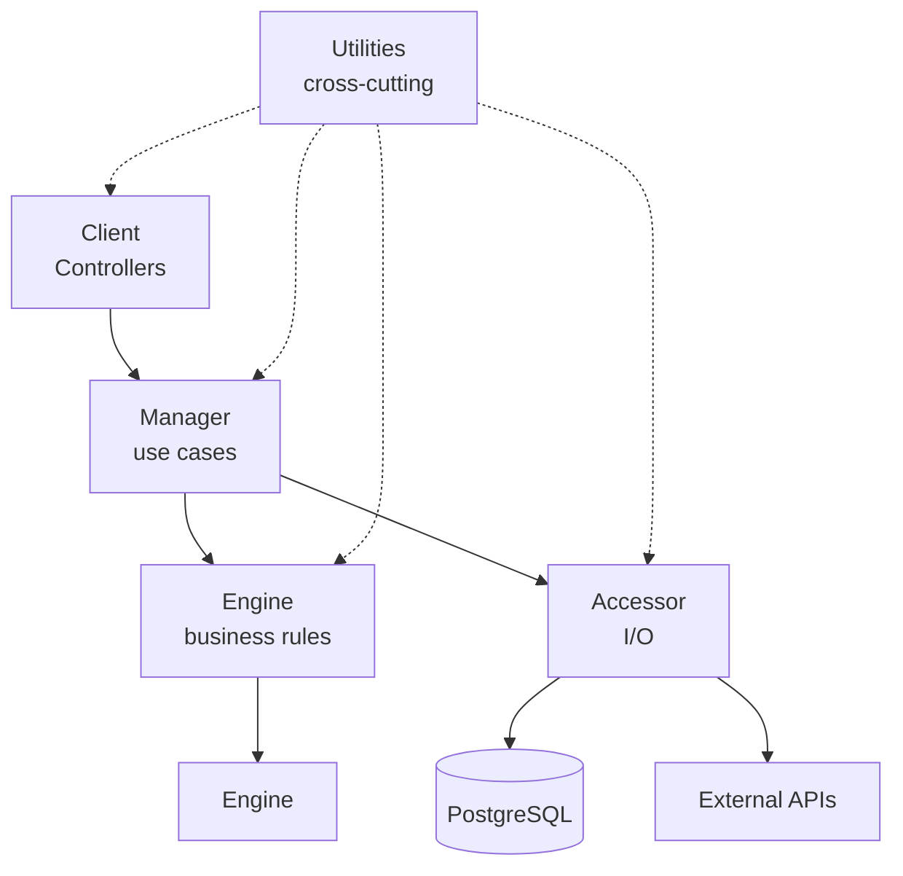
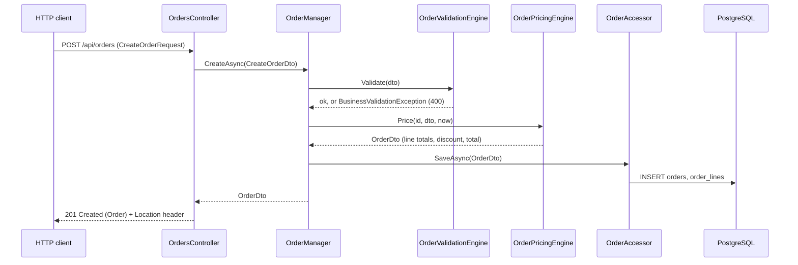
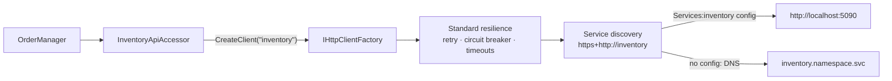
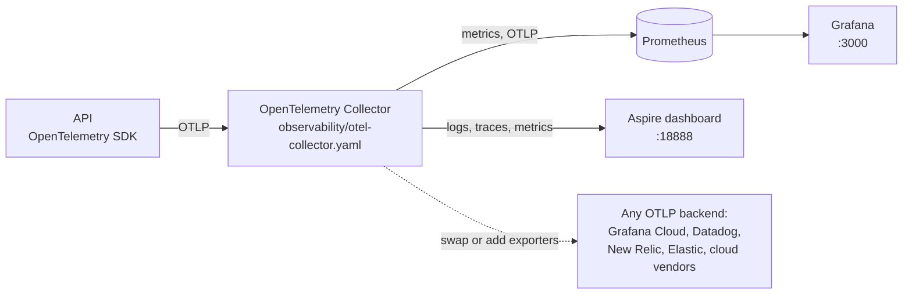

# Company.Product API

An ASP.NET Core Web API (.NET 10) built with the **iDesign Method**: one project, five layers, strict one-way dependencies. The layering, XML docs and zero-warning rules are enforced by tests that run in every build, including the Docker build.

- **Endpoints:** Controllers, documented with XML comments
- **API reference:** OpenAPI document + [Scalar](https://scalar.com) UI at `/scalar`
- **Data:** EF Core + PostgreSQL through `IDbContextFactory`. **This API is the only component that talks to its database.**
- **Observability:** OpenTelemetry logs, traces and metrics over OTLP to an OpenTelemetry Collector, so it's cloud-agnostic. Locally, metrics go to Prometheus and Grafana (http://localhost:3000), and logs and traces go to the Aspire dashboard (http://localhost:18888)
- **Other APIs:** `IHttpClientFactory` named clients with service discovery (`https+http://inventory`) and standard resilience
- **Schema:** owned by Liquibase changesets. There are no EF migrations.

---

## Contents

1. [Quick start](#quick-start)
2. [Project structure](#project-structure)
3. [Architecture](#architecture)
4. [Request flow: creating an order](#request-flow-creating-an-order)
5. [Endpoints](#endpoints)
6. [Configuration](#configuration)
7. [Database](#database)
8. [Calling other APIs](#calling-other-apis)
9. [Logging and telemetry](#logging-and-telemetry)
10. [Production telemetry setup](#production-telemetry-setup): Grafana/Prometheus, Azure, AWS, GCP
11. [Testing](#testing)
12. [Build rules: zero warnings and XML docs](#build-rules-zero-warnings-and-xml-docs)
13. [Docker and Kubernetes](#docker-and-kubernetes)
14. [Adding a feature](#adding-a-feature)
15. [Working with Claude](#working-with-claude)
16. [Troubleshooting](#troubleshooting)

---

## Quick start

### Prerequisites

| Tool | Why |
|------|-----|
| [.NET 10 SDK](https://dotnet.microsoft.com/download) | Build and run locally (the version is pinned in `global.json`) |
| [Docker Desktop](https://www.docker.com/products/docker-desktop/) | PostgreSQL for local runs, and the containerized build |
| VS Code + C# Dev Kit | Optional. F5 debugging is preconfigured |

### Option 1: VS Code (recommended)

1. Open this folder in VS Code and install the recommended extensions when prompted.
2. Press **F5** and pick **API + Postgres + Telemetry (Docker)**.

The launch config starts PostgreSQL and the telemetry stack in Docker, waits for them, builds, runs the API on **http://localhost:5080** and opens Scalar in your browser.

| URL | What |
|-----|------|
| http://localhost:5080/scalar | API reference and test client |
| http://localhost:3000 | **Grafana**: metric dashboards (opens on the API dashboard) |
| http://localhost:9090 | **Prometheus**: raw metrics and PromQL |
| http://localhost:18888 | **Aspire dashboard**: structured logs and traces |

Other launch configs and tasks (`Ctrl+Shift+P` → *Run Task*):

| Name | What it does |
|------|--------------|
| **API only (dependencies already running)** | Launch config. Skips starting the Docker dependencies |
| **Attach to process** | Launch config. Attaches the debugger to a running API |
| `build` | `dotnet build` (default build task, `Ctrl+Shift+B`) |
| `test` | `dotnet test` |
| `deps: up` / `deps: down` | Start or stop PostgreSQL, the OpenTelemetry Collector, Prometheus, Grafana and the Aspire dashboard (data is kept) |
| `db: reset` | Delete the database and metrics volumes, then recreate the database from `database/schema.sql` |
| `compose: up (full stack)` | Run the API and every dependency in Docker, with the API on http://localhost:8080 |
| `docker: build + test` | The same build CI runs: compile, all tests, runtime image |

### Option 2: Command line

```bash
docker compose up -d --wait db otel-collector prometheus grafana dashboard
dotnet run --project src/Company.Product.Api        # API on http://localhost:5080
```

Then open http://localhost:5080/scalar. Grafana is at http://localhost:3000, and logs and traces are at http://localhost:18888.

### Option 3: Everything in Docker

```bash
docker compose up --build                           # API on http://localhost:8080
```

Then open http://localhost:8080/scalar. The image build runs every test first, so a broken rule stops the stack from starting.

### Try it

Use `src/Company.Product.Api/Company.Product.Api.http` (VS Code REST Client or Visual Studio), Scalar's *Test Request* button, or curl:

```bash
curl -s -X POST http://localhost:5080/api/orders \
  -H "Content-Type: application/json" \
  -d '{"customerName":"Contoso","lines":[{"sku":"WIDGET-1","quantity":10,"unitPrice":25.00},{"sku":"GADGET-2","quantity":3,"unitPrice":99.99}]}'
```

That order's subtotal is 549.97, so the 5% volume discount applies: discount 27.50, total 522.47.

---

## Project structure

```
.
├── .claude/commands/add-feature.md     /add-feature slash command for Claude Code
├── .vscode/                            launch configs, tasks, recommended extensions
├── database/schema.sql                 local-dev schema, loaded by docker compose (see Database)
├── src/Company.Product.Api/
│   ├── Controllers/                    CLIENT layer: HTTP endpoints
│   │   ├── ErrorHandling/              exception -> ProblemDetails
│   │   └── Mapping/                    API model <-> Dto
│   ├── Managers/                       MANAGER layer: use-case orchestration
│   │   ├── Exceptions/                 NotFoundException, BusinessValidationException
│   │   ├── Models/                     *Dto types
│   │   └── Setup/                      AddManagers()
│   ├── Engines/                        ENGINE layer: pure business logic
│   │   ├── Options/                    options bound from configuration
│   │   └── Setup/                      AddEngines()
│   ├── Accessors/                      ACCESSOR layer: all I/O
│   │   ├── Http/                       HTTP accessors for other APIs (IHttpClientFactory)
│   │   ├── Database/                   AppDbContext
│   │   ├── Exceptions/                 ResourceAccessException
│   │   ├── Mapping/                    Dto <-> Entity
│   │   ├── Models/                     *Entity types (tables, external API shapes)
│   │   └── Setup/                      AddAccessors()
│   ├── Utilities/                      UTILITY layer: cross-cutting helpers
│   │   ├── Telemetry/                  ApplicationTelemetry: ActivitySource + Meter
│   │   └── Setup/                      AddUtilities(), AddTelemetry() (OpenTelemetry)
│   ├── Models/                         API contracts (no suffix)
│   └── Program.cs                      host wiring
├── tests/Company.Product.Api.Tests/
│   ├── Accessors/                      HTTP accessor tests (stub handler)
│   ├── Architecture/                   layering + controller XML doc rules
│   ├── Engines/                        Engine unit tests
│   ├── Managers/                       Manager unit tests
│   └── Telemetry/                      /metrics endpoint test (in-memory API)
├── CLAUDE.md                           architecture rules (for people and for Claude)
├── Directory.Build.props               net10.0, nullable, zero-warning policy
├── Directory.Packages.props            every package version (central package management)
├── Dockerfile                          build + test + runtime image
├── docker-compose.yml                  API + PostgreSQL + OTel Collector + Prometheus + Grafana + Aspire dashboard
├── observability/
│   ├── otel-collector.yaml             where telemetry goes (the only backend-specific config)
│   ├── prometheus.yml                  OTLP ingestion settings
│   └── grafana/                        provisioned datasource + "Company.Product API" dashboard
├── global.json                         SDK pin
└── nuget.config                        single package source
```

---

## Architecture

The iDesign Method splits a service by **what changes together**. Each layer has one job, and calls only go downward.



| Layer | Folder | Does | May inject | Must not |
|-------|--------|------|------------|----------|
| **Client** | `Controllers/` | Map the API model to a Dto, call **one** Manager method, map the result back | Managers | Contain business logic, do I/O, try/catch |
| **Manager** | `Managers/` | Orchestrate a use case: validate → calculate → store | Engines, Accessors | Calculate, do I/O directly, call another Manager |
| **Engine** | `Engines/` | Calculations, validation, decisions | Engines, Utilities | Do **any** I/O (DB, HTTP, cache, files) |
| **Accessor** | `Accessors/` | All I/O, exposed as business verbs (`SaveAsync`, `FindAsync`) | Utilities, I/O primitives | Contain business logic, call another Accessor |
| **Utility** | `Utilities/` | Stateless helpers | Nothing from the layers above | Hold state or reference a layer |

**Utility-equivalents:** `IOptions<T>`, `IOptionsMonitor<T>`, `IOptionsSnapshot<T>`, `IFeatureManager`, `ILogger<T>` and `TimeProvider` may be injected anywhere, including Engines.

**Manager to Manager:** a Manager never calls another Manager. If one use case must trigger another, it publishes a message (Rebus), and a worker calls the API.

**Interface-first:** every Manager, Engine and Accessor has an `I{Name}` interface in the same file, above the class. All components are Singletons.

### Model tiers

| Tier | Suffix | Folder | Example | Seen by |
|------|--------|--------|---------|---------|
| API contract | *(none)* | `Models/` | `Order`, `CreateOrderRequest` | Controllers only |
| Internal | `Dto` | `Managers/Models/` | `OrderDto` | Controllers, Managers, Engines, Accessors |
| Storage shape | `Entity` | `Accessors/Models/` | `OrderEntity` | Accessors only |

Mapping is explicit and happens at the boundary that owns it: `Controllers/Mapping` (API model ↔ Dto) and `Accessors/Mapping` (Dto ↔ Entity). Accessor methods take and return Dtos, so Entities never leave the Accessors folder, and the API contract can change without touching the tables (and the other way around).

### Errors

| Thrown by | Exception | HTTP |
|-----------|-----------|------|
| Engine / Manager | `BusinessValidationException` (with per-field errors) | 400 `ValidationProblemDetails` |
| Manager | `NotFoundException` (for example `OrderNotFoundException`) | 404 `ProblemDetails` |
| Accessor | `ResourceAccessException` (wraps DB/HTTP failures) | 503 `ProblemDetails` |
| Anything else | | 500 `ProblemDetails` |

`Controllers/ErrorHandling/ApiExceptionHandler` does the mapping, so controllers never need try/catch.

---

## Request flow: creating an order



The pricing rule is in `OrderPricingEngine`: line total = quantity × unit price, rounded to cents. If the subtotal is at or above `Pricing:DiscountThreshold`, it takes `Pricing:DiscountPercent` off. Order IDs are UUID v7 (`Guid.CreateVersion7()`), which sort by time and index well.

---

## Endpoints

| Method | Route | Description | Responses |
|--------|-------|-------------|-----------|
| `POST` | `/api/orders` | Create an order | 201, 400, 503 |
| `GET` | `/api/orders/{id}` | Get one order | 200, 404, 503 |
| `GET` | `/api/orders?skip=0&take=50` | List orders, newest first (`take` 1–200) | 200, 400, 503 |
| `GET` | `/api/orders/{id}/availability` | Check stock for an order with the inventory service | 200, 404, 503 |
| `GET` | `/health` | Liveness/readiness probe | 200 |
| `GET` | `/metrics` | Prometheus scrape endpoint (unless turned off) | 200 |
| `GET` | `/scalar` | API reference UI (when docs are enabled) | 200 |
| `GET` | `/openapi/v1.json` | OpenAPI document (when docs are enabled) | 200 |
| `GET` | `/` | Redirects to `/scalar` (when docs are enabled) | 302 |

Error responses use [RFC 9457 ProblemDetails](https://www.rfc-editor.org/rfc/rfc9457). Example 400:

```json
{
  "title": "One or more business rules failed.",
  "status": 400,
  "errors": {
    "Lines[0].Quantity": [ "Quantity must be greater than zero." ]
  }
}
```

Summaries, descriptions and response codes in Scalar come straight from the controllers' XML comments.

---

## Configuration

Standard ASP.NET Core configuration: `appsettings.json`, then `appsettings.{Environment}.json`, then environment variables. Nested keys use `__` in environment variables, for example `ConnectionStrings__Database`.

| Key | Default | Description |
|-----|---------|-------------|
| `ConnectionStrings:Database` | `Host=localhost;Port=5432;Database=product;Username=product;Password=product` | PostgreSQL connection. Required: startup fails without it |
| `Pricing:DiscountThreshold` | `500.00` | Subtotal at or above which the discount applies |
| `Pricing:DiscountPercent` | `5.0` | Discount percentage (5 = 5%). Picked up without a restart (`IOptionsMonitor`) |
| `ExternalApis:Inventory` | `https+http://inventory` | Inventory service base address, resolved by service discovery |
| `Services:inventory:http:0` | `http://localhost:5090` in Development only | Service discovery endpoint for `inventory`. Add `https` entries the same way |
| `OTEL_EXPORTER_OTLP_ENDPOINT` | `http://localhost:4317` in Development, otherwise unset | OpenTelemetry Collector address. When unset, nothing is exported (console logs still work) |
| `OTEL_METRIC_EXPORT_INTERVAL` | `10000` in Development, otherwise 60000 | Milliseconds between metric pushes |
| `OTEL_SERVICE_NAME` | `Company.Product.Api` | Service name on every log, span and metric |
| `Telemetry:PrometheusEndpoint:Enabled` | `true` | Serve Prometheus metrics at `/metrics` for scraping |
| `OTEL_EXPORTER_OTLP_PROTOCOL` | `grpc` | `grpc` or `http/protobuf` |
| `OTEL_EXPORTER_OTLP_HEADERS` | *(none)* | Auth headers for a hosted backend, for example `x-api-key=...` |
| `OTEL_RESOURCE_ATTRIBUTES` | *(none)* | Extra resource attributes, for example `service.namespace=sales` |
| `Logging:Console:FormatterName` | `json` (Production), `simple` (Development) | Console log format |
| `ApiDocs:Enabled` | `true` in Development, otherwise `false` | Serve `/openapi/v1.json`, `/scalar` and the `/` redirect |
| `ASPNETCORE_ENVIRONMENT` | `Production` | `Development` locally (set by launch settings and compose) |
| `ASPNETCORE_HTTP_PORTS` | `8080` in the container | Listening port inside Docker |

The default connection string is for local development only. In real environments, supply it from a secret (a Kubernetes Secret or a key vault) through the `ConnectionStrings__Database` environment variable.

---

## Database

- **Engine:** PostgreSQL 17 locally, via `docker compose`.
- **Access:** only through Accessors, using `IDbContextFactory<AppDbContext>`. Each Accessor method creates and disposes its own short-lived `DbContext`, which is what makes Singleton Accessors safe. The context is registered with `AddDbContextFactory` only, and an architecture test fails the build if anything injects a `DbContext` directly.
- **Mapping:** `Accessors/Database/AppDbContext.cs` maps entities to snake_case tables and columns explicitly.
- **Schema ownership:** Liquibase changesets (with rollbacks) own every schema change. **Do not add EF Core migrations.**
- **Local schema:** `database/schema.sql` is loaded by the PostgreSQL container on its first start only. After changing it, run the `db: reset` task (or `docker compose down -v`). The real schema lives in a separate Liquibase project (`dotnet new db-liquibase`), which creates the same tables with rollbacks. Once you have one, stop mounting `schema.sql` and run that project's migration image against this database instead.

| Table | Key | Columns |
|-------|-----|---------|
| `orders` | `id` | `customer_name`, `subtotal`, `discount`, `total`, `created_at` |
| `order_lines` | `order_id`, `line_number` | `sku`, `quantity`, `unit_price`, `line_total` (FK to `orders`, cascade delete) |

**Nothing else reads these tables.** Workers, other services and UIs call this API. If a consumer needs data this API doesn't expose, add an endpoint.

---

## Calling other APIs

Other services are called only from **HTTP Accessors** in `Accessors/Http/`, one per service. The sample is `InventoryApiAccessor`, used by `GET /api/orders/{id}/availability`.



**How it's wired** (`Accessors/Setup/AccessorsSetup.cs`):

```csharp
services.AddServiceDiscovery();
services.ConfigureHttpClientDefaults(http =>
{
    http.AddStandardResilienceHandler();   // every client: retry, circuit breaker, timeouts
    http.AddServiceDiscovery();            // every client: logical names -> real endpoints
});

services.AddHttpClient(InventoryApiAccessor.HttpClientName, client =>
    client.BaseAddress = new Uri(configuration["ExternalApis:Inventory"] ?? "https+http://inventory"));

services.AddSingleton<IInventoryApiAccessor, InventoryApiAccessor>();
```

**How the name resolves:**

| Where | Configuration | Resolves to |
|-------|---------------|-------------|
| Local (Development) | `"Services": { "inventory": { "http": [ "http://localhost:5090" ] } }` in `appsettings.Development.json` | `http://localhost:5090` |
| Docker Compose | `Services__inventory__http__0=http://inventory:8080` | the `inventory` container |
| Kubernetes | nothing: the name passes through to DNS | the `inventory` Service in the same namespace |
| Anywhere | `ExternalApis__Inventory=https://inventory.example.com` | a fixed address, no discovery |

`https+http` prefers an `https` endpoint and uses `http` when that's all that's configured. If the Kubernetes Service only serves HTTP, set `Services__inventory__http__0=http://inventory:8080` (or point `ExternalApis__Inventory` at `http://inventory:8080`).

**Rules** (enforced by architecture tests):

- Inject `IHttpClientFactory` and call `CreateClient(name)` per call. Never inject `HttpClient` or use typed clients: Accessors are Singletons and would hold one client forever.
- Only Accessors may inject `IHttpClientFactory` (or `IDbContextFactory<T>`).
- The external API's JSON shapes are `...Entity` types. Accessor methods take and return Dtos.
- Transport failures (`HttpRequestException`, Polly rejections, timeouts, bad JSON) become `ResourceAccessException`, which is a 503. The caller's cancellation is not wrapped.

**Adding another service:** create `Accessors/Http/{Name}ApiAccessor.cs` with an interface and a `HttpClientName` constant. Register a named client with an `ExternalApis:{Name}` key defaulting to `https+http://{name}`, add a `Services:{name}` entry to `appsettings.Development.json`, and inject the Accessor interface into the Manager that needs it.

Without the inventory service running, `GET /api/orders/{id}/availability` returns 503 after the resilience retries. Everything else works.

---

## Logging and telemetry

The API sends **logs, traces and metrics** through [OpenTelemetry](https://opentelemetry.io/). It's configured in `Utilities/Setup/TelemetrySetup.cs` and wired with one line in `Program.cs`: `builder.AddTelemetry();`.

**It's cloud-agnostic.** The API only speaks OTLP, the vendor-neutral OpenTelemetry protocol, to an **OpenTelemetry Collector**. The Collector's config decides where each signal goes. The API has no vendor SDKs, and every local component is open source and runs the same on any cloud, any Kubernetes cluster, or on-prem.



| Signal | What's collected |
|--------|------------------|
| **Logs** | Everything written through `ILogger<T>`, with the formatted message, scopes, and the **trace ID and span ID** of the request that wrote it |
| **Traces** | Incoming requests (except `/health`), outgoing `HttpClient` calls (including service discovery and retries), PostgreSQL commands (Npgsql), and custom spans from `ApplicationTelemetry.ActivitySource` |
| **Metrics** | ASP.NET Core and Kestrel, `HttpClient`, .NET runtime (`System.Runtime`), EF Core, Npgsql, Polly resilience, and custom metrics from `ApplicationTelemetry.Meter` (the sample is `orders.created`) |

### Viewing it locally

F5 (or the `deps: up` task) starts the stack. `appsettings.Development.json` points the API at the Collector (`OTEL_EXPORTER_OTLP_ENDPOINT=http://localhost:4317`).

| Tool | URL | Use it for |
|------|-----|------------|
| **Grafana** | http://localhost:3000 | Metrics over time. It opens on the provisioned **Company.Product API** dashboard |
| **Prometheus** | http://localhost:9090 | Ad-hoc PromQL queries and checking which series exist |
| **Aspire dashboard** | http://localhost:18888 | Structured logs (filter by `OrderId`, jump from a log to its trace) and traces for each request |

The **Company.Product API** Grafana dashboard (`observability/grafana/dashboards/api-overview.json`) has:

- **Overview:** requests/sec, 5xx error rate, p95 latency, and orders created in the last hour
- **HTTP server:** requests/sec and p95 latency by route, responses by status code, and active requests
- **Dependencies:** outgoing HTTP p95 latency and failures for each called service
- **.NET runtime:** working set, GC collections and thread pool queue

Grafana and the Aspire dashboard run without logins here, so this setup is only for development. Grafana allows edits in the UI, but they aren't saved to the JSON file. Export the dashboard and replace the file to keep changes.

### Metric names in Prometheus

Prometheus stores OTLP metrics under Prometheus-style names:

| OpenTelemetry | Prometheus |
|---------------|------------|
| `http.server.request.duration` (s) | `http_server_request_duration_seconds_bucket` / `_count` / `_sum` |
| `http.client.request.duration` (s) | `http_client_request_duration_seconds_*` |
| `orders.created` (counter) | `orders_created_total` |
| `dotnet.gc.collections` | `dotnet_gc_collections_total` |
| attribute `http.route` | label `http_route` |
| resource `service.name` | label `job` |

Example PromQL: p95 latency per route:

```promql
histogram_quantile(0.95, sum by (le, http_route) (rate(http_server_request_duration_seconds_bucket{job="Company.Product.Api"}[5m])))
```

### Writing logs

```csharp
// Good: structured. OrderId and Total become searchable fields.
logger.LogInformation("Created order {OrderId} totaling {Total}", order.Id, order.Total);

// Bad: interpolation flattens everything into one string.
logger.LogInformation($"Created order {order.Id} totaling {order.Total}");
```

- Inject `ILogger<T>`, which is allowed in every layer.
- `Information` for business events, `Warning` for handled problems, `Error` (passing the exception) for failures.
- Never log secrets, tokens, connection strings or personal data.
- Don't log and rethrow: unhandled exceptions are logged once by ASP.NET Core, and 503s by `ApiExceptionHandler`.

### Custom spans and metrics

```csharp
private static readonly Counter<long> OrdersCreated =
    ApplicationTelemetry.Meter.CreateCounter<long>("orders.created", unit: "{order}");

using var activity = ApplicationTelemetry.ActivitySource.StartActivity("OrderManager.Create");
activity?.SetTag("order.id", order.Id);
OrdersCreated.Add(1);
```

### Exposing metrics: push and pull

The API offers its metrics both ways, so it fits any monitoring setup:

| Mode | How | Turned on by | Use when |
|------|-----|--------------|----------|
| **Push (OTLP)** | The API sends metrics, logs and traces to an OpenTelemetry Collector | `OTEL_EXPORTER_OTLP_ENDPOINT` | You run a Collector: recommended, and the only mode that also carries logs and traces |
| **Pull (Prometheus scrape)** | `GET /metrics` in Prometheus text format | On by default. `Telemetry__PrometheusEndpoint__Enabled=false` turns it off | Prometheus (or a managed Prometheus) scrapes pods directly |

```bash
curl http://localhost:5080/metrics
# TYPE http_server_request_duration_seconds histogram
# TYPE orders_created_total counter
# TYPE dotnet_gc_collections_total counter
...
```

- `/metrics` and `/health` are excluded from traces.
- `/metrics` is served on the API port (8080). Don't expose it through the public ingress: keep it cluster-internal, or turn it off if you only use push.
- `MetricsEndpointTests` starts the API in memory and fails the build if `/metrics` stops working.
- Use push or pull for a given Prometheus, not both, or every series is stored twice under two `job` labels.
- The scrape endpoint uses `OpenTelemetry.Exporter.Prometheus.AspNetCore`, which is still a prerelease package. OTLP push is the fully stable path.

---

## Production telemetry setup

**The API is configured the same way everywhere.** Only the OpenTelemetry Collector's exporters change per platform:

```bash
# API container: identical on every platform
OTEL_EXPORTER_OTLP_ENDPOINT=http://otel-collector.observability:4317
OTEL_SERVICE_NAME=sales-api
OTEL_RESOURCE_ATTRIBUTES=service.namespace=sales,deployment.environment.name=production
ASPNETCORE_ENVIRONMENT=Production        # JSON console logs, API docs off
```

Run the Collector (`otel/opentelemetry-collector-contrib`, or the cloud vendor's distribution) as a Deployment or DaemonSet in the `observability` namespace. Every Collector config below starts from this base. Each platform section shows only its `exporters` and `service.pipelines`:

```yaml
receivers:
  otlp:
    protocols:
      grpc: { endpoint: 0.0.0.0:4317 }
      http: { endpoint: 0.0.0.0:4318 }

processors:
  memory_limiter: { check_interval: 1s, limit_percentage: 80, spike_limit_percentage: 25 }
  batch: {}
  k8sattributes: {}            # adds k8s.namespace.name, k8s.pod.name, ... (needs RBAC to read pods)
  resourcedetection:
    detectors: [env, system]   # add aks / eks / ec2 / gcp per platform
```

Container stdout logs (JSON) are also picked up by every platform's node-level log agent. That's a fallback: OTLP logs carry trace IDs and structured fields, so prefer them.

| Platform | Logs | Traces | Metrics | Dashboards |
|----------|------|--------|---------|------------|
| [Standard (open source)](#standard-grafana-prometheus-loki-tempo) | Loki | Tempo | Prometheus | Grafana |
| [Azure](#azure) | Application Insights / Log Analytics | Application Insights | Azure Monitor managed Prometheus (or Application Insights) | Azure Managed Grafana |
| [AWS](#aws) | CloudWatch Logs | X-Ray | Amazon Managed Service for Prometheus (or CloudWatch) | Amazon Managed Grafana |
| [GCP](#gcp) | Cloud Logging | Cloud Trace | Google Cloud Managed Service for Prometheus | Cloud Monitoring or Grafana |

### Standard: Grafana, Prometheus, Loki, Tempo

The self-hosted, fully open-source stack. It runs the same on any Kubernetes cluster or VM, and matches local development (which adds Loki and Tempo in place of the Aspire dashboard).

**Collector exporters:**

```yaml
exporters:
  otlp_http/prometheus:            # Prometheus 3+ with --web.enable-otlp-receiver
    endpoint: http://prometheus.observability:9090/api/v1/otlp
  otlp_http/loki:                  # Loki 3+ native OTLP ingestion
    endpoint: http://loki.observability:3100/otlp
  otlp_grpc/tempo:
    endpoint: tempo.observability:4317
    tls: { insecure: true }

service:
  pipelines:
    metrics: { receivers: [otlp], processors: [memory_limiter, k8sattributes, batch], exporters: [otlp_http/prometheus] }
    logs:    { receivers: [otlp], processors: [memory_limiter, k8sattributes, batch], exporters: [otlp_http/loki] }
    traces:  { receivers: [otlp], processors: [memory_limiter, k8sattributes, batch], exporters: [otlp_grpc/tempo] }
```

**Prometheus:** start it with `--web.enable-otlp-receiver` and use the `otlp:` / `out_of_order_time_window` settings from `observability/prometheus.yml`.

**Or pull instead of push.** Remove the metrics pipeline and let Prometheus scrape `/metrics`. With the Prometheus Operator (kube-prometheus-stack):

```yaml
apiVersion: monitoring.coreos.com/v1
kind: ServiceMonitor
metadata:
  name: sales-api
  labels: { release: kube-prometheus-stack }   # must match the Prometheus serviceMonitorSelector
spec:
  selector:
    matchLabels: { app: sales-api }            # labels on the API's Service
  endpoints:
    - port: http                               # the Service port name for 8080
      path: /metrics
      interval: 30s
```

Plain Prometheus without the Operator uses a `kubernetes_sd_configs` scrape job with pod annotations (`prometheus.io/scrape: "true"`, `prometheus.io/port: "8080"`, `prometheus.io/path: /metrics`).

**Grafana:** add Prometheus, Loki and Tempo data sources. Link Loki to Tempo on the `trace_id` field so a log line opens its trace. Import `observability/grafana/dashboards/api-overview.json`.

### Azure

**Option 1: Azure Monitor / Application Insights for everything.** Create an Application Insights resource backed by a Log Analytics workspace, and store its connection string in Key Vault.

```yaml
exporters:
  azuremonitor:
    connection_string: ${env:APPLICATIONINSIGHTS_CONNECTION_STRING}

service:
  pipelines:
    logs:    { receivers: [otlp], processors: [memory_limiter, batch], exporters: [azuremonitor] }
    traces:  { receivers: [otlp], processors: [memory_limiter, batch], exporters: [azuremonitor] }
    metrics: { receivers: [otlp], processors: [memory_limiter, batch], exporters: [azuremonitor] }
```

Where the data lands: logs in `AppTraces`, incoming requests in `AppRequests`, outgoing calls and SQL in `AppDependencies`, and custom metrics in `AppMetrics`. The Application Map and transaction search work on the traces.

**Option 2: Prometheus metrics (recommended for metrics on AKS).** Enable **Azure Monitor managed service for Prometheus** on the AKS cluster (the `ama-metrics` add-on) with an **Azure Monitor workspace**, link **Azure Managed Grafana**, and have it scrape `/metrics`:

```yaml
apiVersion: azmonitoring.coreos.com/v1
kind: PodMonitor
metadata:
  name: sales-api
spec:
  selector:
    matchLabels: { app: sales-api }
  podMetricsEndpoints:
    - port: http
      path: /metrics
```

Import `observability/grafana/dashboards/api-overview.json` into Azure Managed Grafana. The PromQL is the same. Keep logs and traces on the `azuremonitor` exporter (Option 1 without the metrics pipeline).

**Also on Azure:**

- **Container logs:** Container insights (AKS) or Container Apps logging collects stdout JSON into Log Analytics (`ContainerLogV2`).
- **Resource detection:** add `aks` to `resourcedetection.detectors`.
- **Azure Container Apps:** it has a managed OpenTelemetry agent. Point it at Application Insights and it sets `OTEL_EXPORTER_OTLP_ENDPOINT` in your app, so you don't run a Collector. The same code works.

### AWS

Use the contrib Collector, or **AWS Distro for OpenTelemetry (ADOT)**, which bundles the AWS exporters and runs as an EKS add-on. Grant AWS permissions to the Collector's service account with **EKS Pod Identity** or **IRSA**: `CloudWatchAgentServerPolicy`, `AWSXrayWriteOnlyAccess`, and `AmazonPrometheusRemoteWriteAccess` for managed Prometheus.

```yaml
extensions:
  sigv4auth:
    region: us-east-1
    service: aps

exporters:
  awsxray:                                      # traces -> AWS X-Ray
    region: us-east-1
  awscloudwatchlogs:                            # logs -> CloudWatch Logs
    region: us-east-1
    log_group_name: /apps/sales-api
    log_stream_name: otel
  prometheusremotewrite:                        # metrics -> Amazon Managed Service for Prometheus
    endpoint: https://aps-workspaces.us-east-1.amazonaws.com/workspaces/<workspace-id>/api/v1/remote_write
    auth: { authenticator: sigv4auth }
    resource_to_telemetry_conversion: { enabled: true }
  # Alternative for metrics: CloudWatch metrics via Embedded Metric Format
  # awsemf: { region: us-east-1, namespace: SalesApi, log_group_name: /metrics/sales-api }

service:
  extensions: [sigv4auth]
  pipelines:
    traces:  { receivers: [otlp], processors: [memory_limiter, resourcedetection, batch], exporters: [awsxray] }
    logs:    { receivers: [otlp], processors: [memory_limiter, resourcedetection, batch], exporters: [awscloudwatchlogs] }
    metrics: { receivers: [otlp], processors: [memory_limiter, resourcedetection, batch], exporters: [prometheusremotewrite] }
```

**Also on AWS:**

- **Dashboards:** connect **Amazon Managed Grafana** to the Prometheus workspace, CloudWatch and X-Ray, and import `api-overview.json`.
- **Pull instead of push:** the ADOT Collector's `prometheus` receiver, or an AMP managed scraper, can scrape `/metrics`.
- **Resource detection:** add `eks` and `ec2` to `resourcedetection.detectors`.
- **Container logs:** Fluent Bit (the CloudWatch Observability EKS add-on) ships stdout JSON to CloudWatch Logs.

### GCP

Use the contrib Collector (or Google's build of it) with **Workload Identity** on its service account. Grant `roles/logging.logWriter`, `roles/cloudtrace.agent` and `roles/monitoring.metricWriter`.

```yaml
processors:
  resourcedetection:
    detectors: [env, gcp]

exporters:
  googlecloud:                                  # traces -> Cloud Trace, logs -> Cloud Logging
    log:
      default_log_name: sales-api
  googlemanagedprometheus: {}                   # metrics -> Managed Service for Prometheus

service:
  pipelines:
    traces:  { receivers: [otlp], processors: [memory_limiter, resourcedetection, batch], exporters: [googlecloud] }
    logs:    { receivers: [otlp], processors: [memory_limiter, resourcedetection, batch], exporters: [googlecloud] }
    metrics: { receivers: [otlp], processors: [memory_limiter, resourcedetection, batch], exporters: [googlemanagedprometheus] }
```

**Or pull instead of push:** on GKE with Managed Service for Prometheus turned on, scrape `/metrics` directly:

```yaml
apiVersion: monitoring.googleapis.com/v1
kind: PodMonitoring
metadata:
  name: sales-api
spec:
  selector:
    matchLabels: { app: sales-api }
  endpoints:
    - port: http
      path: /metrics
      interval: 30s
```

**Also on GCP:**

- **Dashboards:** query with PromQL in Cloud Monitoring, or point Grafana at Managed Service for Prometheus through the data source syncer and import `api-overview.json`.
- **Container logs:** GKE ships stdout to Cloud Logging automatically. JSON lines become structured `jsonPayload` entries.

### Checklist for any platform

- [ ] The Collector is deployed and reachable at the `OTEL_EXPORTER_OTLP_ENDPOINT` value.
- [ ] The Collector's identity can write to the backends (Key Vault connection string, IAM role, or Workload Identity).
- [ ] `OTEL_SERVICE_NAME` and `deployment.environment.name` are set, so dashboards can filter by service and environment.
- [ ] Metrics use push **or** pull for a given Prometheus, not both.
- [ ] `/metrics` isn't reachable from the public ingress.
- [ ] `api-overview.json` is imported into Grafana, and the **Service** drop-down shows your service.
- [ ] A log line in the backend links to its trace (check the trace ID field).

---

## Testing

```bash
dotnet test
```

| Suite | Folder | Covers |
|-------|--------|--------|
| Engine tests | `tests/.../Engines/` | Pricing math, discount threshold, validation rules. Pure functions with no mocks except options |
| Manager tests | `tests/.../Managers/` | Orchestration with NSubstitute fakes: validate → price → save, not-found, no save when validation fails, availability |
| Accessor tests | `tests/.../Accessors/` | HTTP Accessor: request URL, response mapping, failure wrapping. Uses a stub `HttpMessageHandler`, so no network |
| Architecture tests | `tests/.../Architecture/ArchitectureTests.cs` | The iDesign rules (below) |
| Documentation tests | `tests/.../Architecture/ControllerDocumentationTests.cs` | Controller XML docs are complete |
| Metrics endpoint tests | `tests/.../Telemetry/MetricsEndpointTests.cs` | Starts the API in memory: `/metrics` serves Prometheus metrics and can be turned off |

### Architecture rules enforced

| Test | Fails when |
|------|------------|
| `Controllers_inject_only_managers` | A controller constructor takes anything but a Manager interface |
| `Managers_inject_only_engines_accessors_and_utilities` | A Manager injects another Manager or an I/O type |
| `Engines_inject_only_engines_and_utilities` | An Engine injects an Accessor or an I/O type |
| `Accessors_do_not_inject_other_layers` | An Accessor injects another Accessor, an Engine or a Manager |
| `DbContext_is_never_injected_directly` | Anything injects a `DbContext` instead of `IDbContextFactory<T>` |
| `HttpClient_is_never_injected_directly` | Anything injects `HttpClient` instead of `IHttpClientFactory` |
| `Only_accessors_use_database_or_http_factories` | Something outside Accessors injects `IDbContextFactory<T>` or `IHttpClientFactory` |
| `Engines_do_no_io` | Engine code references EF Core, Npgsql, `System.Net.Http`, `System.IO`, caching or Accessors |
| `Utilities_do_not_depend_on_layers` | A Utility references any layer |
| `Entities_stay_inside_accessors` | Anything outside Accessors references an `*Entity` |
| `Api_models_stay_in_controllers` | Anything below Controllers references an API model |
| `Components_have_matching_interface` | A Manager, Engine or Accessor has no `I{Name}` interface |
| `Model_suffixes_match_tier` | A type in `Managers/Models` lacks `Dto`, a type in `Accessors/Models` lacks `Entity`, or an API model has either suffix |
| `Controllers_and_actions_have_complete_xml_docs` | A controller or action is missing `<summary>`, `<param>`, `<returns>`, or a `<response>` for a declared status code |

When one of these fails, fix the code. The tests are the contract.

---

## Build rules: zero warnings and XML docs

**Zero warnings.** `Directory.Build.props` turns every compiler, analyzer, NuGet and MSBuild warning into an error. The NuGet vulnerability audit covers transitive packages at every severity. The Dockerfile uses `# check=error=true`, so Dockerfile lint warnings fail the image build too.

- Fix the cause. Only use `#pragma warning disable`, `NoWarn` or `[SuppressMessage]` when there is truly no fix, and add a comment on the same line explaining why.
- If a transitive package has a vulnerability, add a version pin under **Security pins** in `Directory.Packages.props`. Right now `Microsoft.OpenApi` is pinned to 2.7.5 for GHSA-v5pm-xwqc-g5wc.

**XML docs.** They're required on every public type and member, and missing or broken docs are build errors (CS1591, CS1573, CS1572, CS1574, CS1734).

- Interfaces carry the full docs. Implementations use `/// <inheritdoc />`.
- Primary constructors and positional records document their parameters with `<param>` on the type.
- Controllers need a `<summary>` on the class. Each action needs `<summary>`, a `<param>` for every parameter (including `cancellationToken`), `<returns>`, and a `<response code="...">` for every `[ProducesResponseType]`.

**Packages.** Versions live only in `Directory.Packages.props`. `nuget.config` has one source (nuget.org), and `global.json` pins the SDK.

---

## Docker and Kubernetes

The `Dockerfile` is multi-stage:

1. **build** (`sdk:10.0`): restores (cached until a project file changes), builds in Release, **runs all tests**, and publishes.
2. **final** (`aspnet:10.0`): copies only the published output. It runs as numeric non-root user `1654` and listens on `8080`.

```bash
docker build -t company-product-api .
docker run --rm -p 8080:8080 \
  -e ConnectionStrings__Database="Host=host.docker.internal;Port=5432;Database=product;Username=product;Password=product" \
  company-product-api
```

Kubernetes notes:

- Use `/health` for liveness and readiness probes on port `8080`.
- Metrics: push with OTLP to a Collector, or scrape `/metrics` on port `8080` (ServiceMonitor, PodMonitor or PodMonitoring). See [Production telemetry setup](#production-telemetry-setup).
- The numeric user works with `securityContext.runAsNonRoot: true`.
- Supply `ConnectionStrings__Database` from a Secret. Leave `ApiDocs__Enabled` unset (off) unless the cluster should serve the docs.
- Point `OTEL_EXPORTER_OTLP_ENDPOINT` at your OpenTelemetry Collector (or backend). Console logs are JSON for the node's log collector either way.
- Other APIs are found by Kubernetes Service name through service discovery. Nothing needs configuring when the Service name matches (`inventory`).
- Run Liquibase (as a Job or init container) before rolling out a version that needs new schema.

---

## Adding a feature

Follow the layers from the bottom up. Using a hypothetical "cancel order" feature as the example:

1. **API model** in `Models/` (no suffix), if the request or response shape is new.
2. **Dto** in `Managers/Models/` (`...Dto`).
3. **Entity** in `Accessors/Models/` (`...Entity`), if storage changes. Add the Liquibase changeset, with a rollback, in the database repo.
4. **Accessor** method, a business verb such as `IOrderAccessor.CancelAsync`. Wrap failures in `ResourceAccessException`.
5. **Engine** logic, for example "only orders less than 24 hours old can be cancelled." Extend an existing Engine when the responsibility matches, and create a new one for a new responsibility.
6. **Manager** method that orchestrates Engine + Accessor.
7. **Controller** action that injects only the Manager, with `[ProducesResponseType]` for every status code and full XML docs.
8. **Register** new components in the matching `Setup/` extension method.
9. **Tests** for the Engine rules and the Manager orchestration.
10. Run `dotnet build` and `dotnet test`. The architecture and doc tests tell you if a rule was missed.

---

## Working with Claude

`CLAUDE.md` holds the architecture rules, and Claude Code loads it automatically. To scaffold a feature across all layers:

```
/add-feature cancel an order within 24 hours of creation
```

The command follows the steps above, writes XML docs, lists any Liquibase changes needed, and runs the build and tests.

---

## Troubleshooting

| Symptom | Fix |
|---------|-----|
| `Connection string 'Database' is not configured` at startup | Set `ConnectionStrings__Database` or keep the default in `appsettings.json` |
| 503 `A backing resource is unavailable` | PostgreSQL isn't running or reachable: run the `db: up` task or `docker compose up -d --wait db` |
| 503 from `/availability` only | The inventory service isn't reachable. Check `Services:inventory` (or `ExternalApis:Inventory`) and that the service is running |
| `relation "orders" does not exist` | The volume was created before the schema existed: run the `db: reset` task |
| Port 5432 already in use | Stop the local PostgreSQL, or change the port in `docker-compose.yml` and `appsettings.json` |
| Build error `MSB3026`/`MSB3027` (file locked) | The API is still running. Stop debugging, then rebuild |
| Build error `CS1591` | A public member has no XML doc comment. Add one |
| Build error `NU1901`–`NU1904` | A package has a known vulnerability. Pin a fixed version under *Security pins* |
| No telemetry anywhere | Check the stack is running (`deps: up`) and that `OTEL_EXPORTER_OTLP_ENDPOINT` is `http://localhost:4317` (host) or `http://otel-collector:4317` (inside compose). Check `docker compose logs otel-collector` |
| Grafana panels say "No data" | Send a few requests first. Metrics are pushed every 10 seconds in Development (`OTEL_METRIC_EXPORT_INTERVAL`) and every 60 seconds otherwise. Pick the service in the **Service** drop-down, and check the series exists in Prometheus (http://localhost:9090) |
| `/metrics` returns 404 | `Telemetry__PrometheusEndpoint__Enabled` is `false` |
| Every metric appears twice in Prometheus | It's being both pushed (OTLP) and scraped (`/metrics`). Use one of them for that Prometheus |
| Port 3000, 4317, 9090 or 18888 already in use | Another tool is using it. Stop it, or change the host port in `docker-compose.yml` (and `appsettings.Development.json` for 4317) |
| `/scalar` returns 404 | Docs are off outside Development. Set `ApiDocs__Enabled=true` |
| Architecture test fails | Read the message: it names the class and the forbidden dependency. Move the logic to the right layer |
