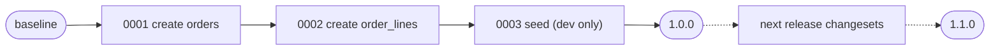

# Company.Product.Database

The database schema as [Liquibase](https://www.liquibase.com/) changesets (XML), shipped as a Docker image that migrates any PostgreSQL database **up** (apply) or **down** (roll back).

- Every changeset has an explicit rollback, and the build fails without one.
- Every release is tagged, so "down" means "roll back to the previous release".
- A round-trip test proves each change applies, rolls back cleanly and applies again.
- It's cloud-agnostic: the same image runs locally, in CI, as a Kubernetes Job, a Container Apps job, an ECS task or a Cloud Run job.
- The API never changes the schema. This image is the only thing that does.

---

## Contents

1. [Quick start](#quick-start)
2. [How it works](#how-it-works)
3. [Up and down](#up-and-down)
4. [Adding a change](#adding-a-change)
5. [Build-time checks and the round-trip test](#build-time-checks-and-the-round-trip-test)
6. [Configuration](#configuration)
7. [Deploying](#deploying)
8. [Licensing](#licensing)
9. [Troubleshooting](#troubleshooting)

---

## Quick start

You only need Docker. There's nothing to install locally: Liquibase, Java and the PostgreSQL driver are in the image.

```bash
docker compose up -d --wait db              # PostgreSQL on localhost:5432 (db/user/password: product)
docker compose run --rm --build migrate     # up: build the image (runs the checks) and apply everything
docker compose run --rm migrate history     # what's applied
```

The local database now has `orders` and `order_lines`, plus two sample orders from the `dev` context. The API template connects to it with its default settings.

In **VS Code**, the tasks (`Ctrl+Shift+P` → *Run Task*) cover all of this:

| Task | What it does |
|------|--------------|
| `docker: build + checks` | Builds the image, which runs every changelog check (default build task, `Ctrl+Shift+B`) |
| `db: up` | Starts PostgreSQL |
| `migrate: update (up)` | Applies pending changesets |
| `migrate: status` / `migrate: history` | Shows pending or applied changesets |
| `migrate: preview update SQL` | Prints the SQL `update` would run |
| `migrate: rollback to tag (down)` | Prompts for a tag and undoes everything applied after it |
| `migrate: preview rollback SQL` | Prints the SQL that rollback would run |
| `migrate: rollback count (down)` | Undoes the last N changesets |
| `verify: round trip` | Up, down, up on a throwaway database (default test task) |
| `db: reset` | Deletes the local database and applies everything again |

---

## How it works

```
changelog/changelog.xml                 master: releases in order
├── releases/baseline.xml               tag: baseline   (empty database)
└── releases/1.0.0/changelog.xml
    ├── 0001-create-orders.xml          orders + ix_orders_created_at
    ├── 0002-create-order-lines.xml     order_lines + fk to orders (cascade)
    ├── 0003-seed-dev-orders.xml        sample data, context="dev" only
    └── tag-1.0.0                       tag: 1.0.0
```



- Liquibase records every applied changeset in the `databasechangelog` table (id, author, file, checksum), and uses `databasechangeloglock` so only one migration runs at a time.
- `update` applies only the changesets that aren't recorded yet, so it's safe to run on every deployment.
- Tags mark release boundaries. `rollback --tag=X` runs the `<rollback>` of every changeset applied after tag `X`, newest first.

A changeset looks like this. The up and the down sit side by side:

```xml
<changeSet id="0001-index-orders-created-at" author="product">
    <comment>Newest-first listing (GET /api/orders).</comment>
    <createIndex tableName="orders" indexName="ix_orders_created_at">
        <column name="created_at" descending="true"/>
    </createIndex>
    <rollback>
        <dropIndex tableName="orders" indexName="ix_orders_created_at"/>
    </rollback>
</changeSet>
```

---

## Up and down

The image runs `update` by default. Pass any other Liquibase command to override it.

| Goal | Command |
|------|---------|
| **Up**: apply everything pending | `update` |
| Up to a specific release only | `update-to-tag --tag=1.0.0` |
| Preview up | `update-sql` |
| **Down**: back to the previous release | `rollback --tag=1.0.0` |
| Down: undo the last N changesets | `rollback-count --count=1` |
| Down: everything | `rollback --tag=baseline` |
| Preview down | `rollback-sql --tag=1.0.0` |
| What's pending / applied | `status --verbose` / `history` |
| Check the changelog against the database | `validate` |
| Unlock after a crashed run | `release-locks` |

Locally, prefix these with `docker compose run --rm migrate`. Anywhere else, run the image with the connection variables:

```bash
docker run --rm \
  -e LIQUIBASE_COMMAND_URL="jdbc:postgresql://db.example.com:5432/product?sslmode=require" \
  -e LIQUIBASE_COMMAND_USERNAME=migrator \
  -e LIQUIBASE_COMMAND_PASSWORD="$DB_PASSWORD" \
  company-product-database:1.0.0 rollback --tag=1.0.0
```

**Rolling back a deployment:** deploy the previous API version, then run the **new** migration image with `rollback --tag=<previous release>`. The new image is the one that contains the rollbacks for the changesets being undone. Always preview with `rollback-sql` first in production.

**Data loss:** rolling back a changeset that dropped a table or column recreates the structure, not the data. Split destructive changes across releases (see [CLAUDE.md](CLAUDE.md), rule 8) so a rollback never needs the old data back.

---

## Adding a change

Say release 1.1.0 adds an order status:

1. Create `changelog/releases/1.1.0/0004-add-orders-status.xml`:

   ```xml
   <?xml version="1.0" encoding="UTF-8"?>
   <databaseChangeLog
       xmlns="http://www.liquibase.org/xml/ns/dbchangelog"
       xmlns:xsi="http://www.w3.org/2001/XMLSchema-instance"
       xsi:schemaLocation="http://www.liquibase.org/xml/ns/dbchangelog
           http://www.liquibase.org/xml/ns/dbchangelog/dbchangelog-latest.xsd">

       <changeSet id="0004-add-orders-status" author="product">
           <comment>Order lifecycle status. Existing orders become 'placed'.</comment>
           <addColumn tableName="orders">
               <column name="status" type="varchar(20)" defaultValue="placed">
                   <constraints nullable="false"/>
               </column>
           </addColumn>
           <rollback>
               <dropColumn tableName="orders" columnName="status"/>
           </rollback>
       </changeSet>

   </databaseChangeLog>
   ```

2. Create `changelog/releases/1.1.0/changelog.xml`, which includes the file and ends with the tag:

   ```xml
   <include file="0004-add-orders-status.xml" relativeToChangelogFile="true"/>

   <changeSet id="tag-1.1.0" author="product">
       <tagDatabase tag="1.1.0"/>
   </changeSet>
   ```

3. Add the release at the end of `changelog/changelog.xml`:

   ```xml
   <include file="releases/1.1.0/changelog.xml" relativeToChangelogFile="true"/>
   ```

4. Build and test:

   ```bash
   docker compose build migrate                          # checks
   docker compose --profile verify run --rm verify       # up, down, up
   docker compose run --rm migrate update-sql            # SQL for the pull request
   ```

5. Update the API's EF Core mapping (`AppDbContext`) in the same pull request cycle.

**Never edit a changeset that has been applied anywhere.** Liquibase stores each changeset's checksum and refuses to run when an applied one changes. Write a new changeset instead.

---

## Build-time checks and the round-trip test

**`docker build`** runs two checks, and a failure fails the image build:

| Check | Catches |
|-------|---------|
| `scripts/check-changelog.sh` | A changeSet without `<rollback>`, duplicate ids, a `<changeSet>` tag split across lines, XML files not included by any changelog |
| Liquibase `update-sql` against `offline:postgresql` | Invalid XML (checked against the XSD), unknown change types or attributes, broken includes. It needs no database |

**The round-trip test** needs a real PostgreSQL, so it runs through Compose on a throwaway, in-memory database:

```bash
docker compose --profile verify run --rm --build verify
```

It runs `update`, `rollback --tag=baseline`, `update` again, then `status`. An incomplete rollback makes the second `update` fail, for example with "relation already exists". CI runs this for every change.

---

## Configuration

Everything is set through environment variables, and nothing is baked into the image except the changelog.

| Variable | Default in image | Description |
|----------|------------------|-------------|
| `LIQUIBASE_COMMAND_URL` | *(required)* | JDBC URL, e.g. `jdbc:postgresql://host:5432/product?sslmode=require` |
| `LIQUIBASE_COMMAND_USERNAME` | *(required)* | Migration user: owns the schema objects |
| `LIQUIBASE_COMMAND_PASSWORD` | *(required)* | From a secret store, never in files |
| `LIQUIBASE_COMMAND_CONTEXT_FILTER` | `!dev` | Which contexts run. `dev` includes sample data (local only) |
| `LIQUIBASE_COMMAND_CHANGELOG_FILE` | `changelog.xml` | Don't change it: it's part of each changeset's identity |
| `LIQUIBASE_SEARCH_PATH` | `/liquibase/changelog` | Don't change it: it's part of each changeset's identity |
| `LIQUIBASE_SHOW_BANNER` | `false` | |
| `LIQUIBASE_ANALYTICS_ENABLED` | `false` | Turns off Liquibase's anonymous usage analytics |
| `LIQUIBASE_LOG_LEVEL` | `INFO` | `FINE` for detailed troubleshooting |

**Users:** run migrations as a **migration user** that owns the tables. The API connects as a separate **application user** that only has `SELECT/INSERT/UPDATE/DELETE`. Grants are environment-specific, so manage them with your infrastructure tooling. If you do want them here, add them as changesets with `context` per environment.

---

## Deploying

Run the image **before** rolling out the API version that needs the new schema, and only let the API roll out if it succeeds. Changes are additive (rule 8), so the currently running API keeps working against the newer schema.

| Platform | How |
|----------|-----|
| **CI/CD** (GitHub Actions, Azure DevOps, GitLab) | A pipeline step: `docker run --rm -e LIQUIBASE_COMMAND_URL=... <image>` before the deploy step |
| **Kubernetes** | A `Job` (or Helm `pre-upgrade` hook) with the connection from a `Secret`. See below |
| **Azure** | A Container Apps job, or a pipeline step before an App Service slot swap |
| **AWS** | An ECS `RunTask` before the service update, or a pipeline step |
| **GCP** | A Cloud Run job before the service deploy |

Kubernetes Job:

```yaml
apiVersion: batch/v1
kind: Job
metadata:
  name: product-database-migrate-1-0-0
spec:
  backoffLimit: 0                 # never retry a failed migration automatically
  template:
    spec:
      restartPolicy: Never
      containers:
        - name: migrate
          image: <registry>/company-product-database:1.0.0
          args: ["update"]
          envFrom:
            - secretRef:
                name: product-database-migrator   # LIQUIBASE_COMMAND_URL / _USERNAME / _PASSWORD
```

Tag images with the release version (`company-product-database:1.0.0`) so the image for any release, and its rollbacks, can always be run again.

---

## Licensing

Liquibase Community 5.x is released under the **Functional Source License (FSL)**. You can use it free, including in production, to manage your own databases. What it restricts is offering Liquibase itself as a competing commercial product or service. Each release converts to **Apache 2.0** two years after it ships. This template uses the community image `liquibase/liquibase:5.0.3`, and since 5.0 no longer bundles database drivers, the Dockerfile adds the PostgreSQL driver with `lpm`.

---

## Troubleshooting

| Symptom | Fix |
|---------|-----|
| Build fails with `changeSet "..." has no <rollback>` | Add a `<rollback>` block to that changeSet |
| Build fails with `not included by any changelog` | Include the file in its release `changelog.xml`, or delete it if it was never applied |
| `Validation Failed: ... checksum changed` | An applied changeset was edited. Revert the edit and make the change in a new changeset |
| `Waiting for changelog lock...` | A previous run crashed while holding the lock. Run `release-locks` once you're sure no migration is running |
| `relation "..." already exists` in the round trip | A `<rollback>` doesn't fully undo its changeset. Fix the rollback |
| `No suitable driver found for jdbc:postgresql` | The image was built without the driver step. Rebuild from this Dockerfile |
| `lpm add postgresql` fails during build | The build needs internet access to download the driver. Check the proxy or firewall |
| Sample data appeared in a shared environment | Something set `LIQUIBASE_COMMAND_CONTEXT_FILTER=dev` there. Keep the image default (`!dev`) outside local development |
