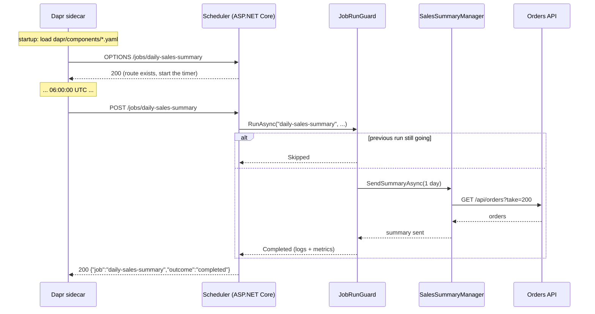

# Company.Product.Scheduler

**Scheduled jobs (cron) that run the same on any cloud, any Kubernetes cluster, or on-prem.**

This app runs code on a schedule, for example "every day at 06:00 UTC, email yesterday's sales summary" or "every 5 minutes, check that the orders API is healthy". It's the cloud-agnostic answer to Azure Functions timer triggers, AWS EventBridge schedules or Google Cloud Scheduler.

Schedules are held by a [Dapr](https://dapr.io) sidecar as `bindings.cron` components (YAML files). When a schedule fires, the sidecar sends an HTTP `POST` to the job's endpoint in this app. **This app doesn't reference Dapr at all.** It's a plain ASP.NET Core app with a few endpoints.

It's the companion of the **`worker-dapr`** template:

| | `worker-dapr` | `scheduler-dapr` (this) |
|---|---|---|
| Runs when | An event or a file arrives | The clock says so |
| Replicas | 0..N, autoscaled on backlog (KEDA) | **Exactly 1, always** |
| Why | A queue gives each message to one replica | Every replica's sidecar fires every schedule |

> ⚠️ **The single most important rule:** run this app as **one replica**, with `strategy: Recreate` and no autoscaling. Two replicas means every job runs twice. [Why](#why-exactly-one-replica).

---

## Contents

1. [Dapr and the cron binding in 5 minutes](#dapr-and-the-cron-binding-in-5-minutes)
2. [Quick start](#quick-start)
3. [The sample jobs](#the-sample-jobs)
4. [What happens during a run, step by step](#what-happens-during-a-run-step-by-step)
5. [Writing schedules](#writing-schedules)
6. [Time zones and daylight saving](#time-zones-and-daylight-saving)
7. [Why exactly one replica](#why-exactly-one-replica)
8. [Guarantees and limits](#guarantees-and-limits)
9. [Overlap protection: JobRunGuard](#overlap-protection-jobrunguard)
10. [Missed runs and catch-up](#missed-runs-and-catch-up)
11. [Long-running jobs and fan-out](#long-running-jobs-and-fan-out)
12. [Adding a job](#adding-a-job)
13. [Configuration](#configuration)
14. [Deploying](#deploying)
15. [Monitoring and alerting](#monitoring-and-alerting)
16. [Security](#security)
17. [Alternatives, and when to switch](#alternatives-and-when-to-switch)
18. [Testing](#testing)
19. [Project structure](#project-structure)
20. [Troubleshooting](#troubleshooting)
21. [FAQ](#faq)

---

## Dapr and the cron binding in 5 minutes

**Dapr** (Distributed Application Runtime) is a free, open-source (Apache 2.0) project of the Cloud Native Computing Foundation, the same foundation behind Kubernetes and Prometheus. It runs as a **sidecar**: a small separate process (`daprd`) next to your app, one per app instance. The app and its sidecar talk over `localhost`.

The sidecar loads **components**, which are YAML files describing things like "a RabbitMQ connection" or "a cron schedule". A **binding** connects your app to something outside it. An **input binding** calls your app when something happens. The **cron binding** is an input binding whose "something" is the clock.

```
┌──────────────────────── one pod (or container app) ────────────────────────┐
│                                                                             │
│   ┌──────────── daprd (sidecar) ────────────┐       ┌──── scheduler ────┐  │
│   │ loads components:                        │       │                   │  │
│   │   daily-sales-summary  "0 0 6 * * *"  ───┼─POST─▶│ /jobs/daily-...   │  │
│   │   orders-api-health    "0 */5 * * * *" ──┼─POST─▶│ /jobs/orders-...  │──┼──▶ orders API
│   │ (a timer per schedule, in the sidecar)   │◀─200──│                   │  │
│   └──────────────────────────────────────────┘       └───────────────────┘  │
└─────────────────────────────────────────────────────────────────────────────┘
```

A cron component looks like this:

```yaml
apiVersion: dapr.io/v1alpha1
kind: Component
metadata:
  name: daily-sales-summary          # the job's name (DailySalesSummaryJob.Name)
spec:
  type: bindings.cron
  version: v1
  metadata:
    - name: schedule
      value: "0 0 6 * * *"           # 06:00:00 UTC every day (6 fields, seconds first)
    - name: direction
      value: "input"
    - name: route
      value: "/jobs/daily-sales-summary"   # the endpoint to call (DailySalesSummaryJob.Route)
scopes:
  - scheduler                        # only the app with app-id "scheduler" loads it
```

That's the whole integration. There's no Dapr SDK, no timer code and no library in the app: **changing a schedule is a YAML change**.

---

## Quick start

**Prerequisites:** .NET 10 SDK, Docker Desktop, VS Code with C# Dev Kit. You don't need the Dapr CLI, because the sidecar runs in Docker. To see the sample jobs do real work, run the **orders API** (the `idesign-api` template) on http://localhost:5080. Without it, the jobs still run and report the API as unhealthy or the run as failed, which is useful to see too.

### VS Code (recommended)

Press **F5** and pick **Scheduler + Dapr (Docker)**. It:

1. Starts the telemetry dashboard and a Dapr sidecar in Docker (`docker compose --profile debug up -d --wait`).
2. Builds and runs the scheduler on **http://localhost:5200**.
3. The sidecar finds the scheduler, checks each job route with `OPTIONS`, and starts the timers.

Locally, the schedules are frequent so you can watch them: the sales summary runs **every minute**, and the health check every **30 seconds**. The Debug Console shows:

```
info: JobRunGuard[0] Starting daily-sales-summary
info: NotificationAccessor[0] Notification: Sales summary 2026-01-15 06:00 to 2026-01-16 06:00 UTC. 2 order(s), revenue 562.47, average order 281.24.
info: JobRunGuard[0] Completed daily-sales-summary in 84 ms
info: JobRunGuard[0] Starting orders-api-health
info: JobRunGuard[0] Completed orders-api-health in 12 ms
```

| URL | What |
|-----|------|
| http://localhost:18888 | Telemetry dashboard: each run's logs and trace (sidecar trigger, then job, then orders API) |
| http://localhost:5200/metrics | Run counts and durations (Prometheus format) |
| `samples/requests.http` | Run any job by hand, exactly like the sidecar does |

VS Code tasks (`Ctrl+Shift+P` → *Run Task*):

| Task | What it does |
|------|--------------|
| `build` / `test` | `dotnet build` / `dotnet test` |
| `deps: up` / `deps: down` | Start or stop the dashboard and the sidecar |
| `dapr: sidecar logs` | Follow the sidecar log: you'll see each component load and each trigger |
| `compose: up (all in containers)` | Scheduler image + sidecar, scheduler on :8081 |
| `docker: build + test` | The CI build: compile, every test, runtime image |

### Command line

```bash
docker compose --profile debug up -d --wait                 # dashboard + sidecar (calls :5200)
dotnet run --project src/Company.Product.Scheduler          # scheduler on :5200
```

### Everything in containers

```bash
docker compose --profile container up --build               # scheduler on :8081
```

---

## The sample jobs

| Job | Component / schedule (local → production) | What it does |
|-----|-------------------------------------------|--------------|
| `DailySalesSummaryJob` | `daily-sales-summary`: `@every 1m` → `0 0 6 * * *` (06:00 UTC daily) | Lists recent orders from the orders API, totals the last 24 hours (`SalesSummaryEngine`), formats a message (`NotificationEngine`) and sends it (`NotificationAccessor`) |
| `OrdersApiHealthJob` | `orders-api-health`: `@every 30s` → `0 */5 * * * *` (every 5 minutes) | Calls the orders API's `/health` and records `dependency.checks` with `outcome=healthy/unhealthy`. Alert on the metric |

`NotificationAccessor` writes to the log. To send real email, SMS or chat messages, replace its body: call a Dapr output binding (SMTP, SendGrid or Twilio), or add an HTTP Accessor for your chat tool's webhook. The Managers don't change.

---

## What happens during a run, step by step



1. **Startup.** The sidecar loads every component in its resources folder (`dapr/components/` locally, the cluster's Component resources in Kubernetes), keeping those whose `scopes` include this app's ID (`scheduler`). For each cron component it sends `OPTIONS <route>` to the app. A `200` means the app listens there, and the sidecar starts that component's timer. `JobsSetup.MapScheduledJob` maps both `OPTIONS` and `POST` for every job route.
2. **The timer fires.** The sidecar sends `POST <route>` with a small JSON body (unused).
3. **The job runs** through `JobRunGuard`:
   - If the same job is still running from the previous tick, this run is **skipped**: logged, counted, and answered with `200 {"outcome":"skipped"}`.
   - Otherwise the Manager is called, and the start, end and duration are logged and measured.
   - If the Manager throws, the run is **failed**: the error is logged with its stack trace and counted.
4. **The response.** `JobResults.From` answers `200` for completed or skipped runs, and `500` (ProblemDetails) for failed runs, so the sidecar also logs the failure. **Either way, the timer carries on and the next run happens on schedule.** There's no automatic retry of a failed run.

---

## Writing schedules

Dapr cron schedules have **6 fields, with seconds first**:

```
┌───────────── second        (0-59)
│ ┌─────────── minute        (0-59)
│ │ ┌───────── hour          (0-23)
│ │ │ ┌─────── day of month  (1-31)
│ │ │ │ ┌───── month         (1-12 or JAN-DEC)
│ │ │ │ │ ┌─── day of week   (0-6 or SUN-SAT, 0 = Sunday)
│ │ │ │ │ │
0 0 6 * * *
```

| Want | Schedule |
|------|----------|
| Every 30 seconds | `*/30 * * * * *` or `@every 30s` |
| Every 5 minutes, on the minute | `0 */5 * * * *` |
| Every 5 minutes, from whenever the app started | `@every 5m` |
| Every hour at :15 | `0 15 * * * *` |
| Every day at 06:00 UTC | `0 0 6 * * *` or `@daily` for midnight |
| Every day at 23:30 UTC | `0 30 23 * * *` |
| Weekdays at 07:30 UTC | `0 30 7 * * MON-FRI` (or `1-5`) |
| Every Monday at 08:00 UTC | `0 0 8 * * MON` |
| 1st of every month at 00:00 UTC | `0 0 0 1 * *` or `@monthly` |
| Every 6 hours | `0 0 */6 * * *` |
| 09:00 and 17:00 UTC | `0 0 9,17 * * *` |
| Every 10 minutes during 08:00-17:59 UTC on weekdays | `0 */10 8-17 * * MON-FRI` |

**Shortcuts:** `@every <duration>` (`30s`, `15m`, `1h`, `1h30m`), `@hourly`, `@daily` (midnight), `@weekly` (Sunday midnight), `@monthly`, `@yearly`.

**`@every` versus a cron expression:** `@every 5m` counts from when the sidecar started, so ticks drift with restarts (10:02, 10:07...). `0 */5 * * * *` lands on the clock (10:00, 10:05...). Use `@every` for "roughly this often" jobs like health checks. Use cron expressions for anything tied to a time of day.

**Coming from classic crontab (5 fields)?** Put a `0 ` in front for "second 0". Crontab `30 2 * * *` becomes Dapr `0 30 2 * * *`. A 5-field expression is **not** read as crontab: the fields shift by one, so it means something else entirely.

| Common mistake | What happens | Fix |
|----------------|--------------|-----|
| `0 6 * * *` (5 fields, meant 06:00) | Read as second 0, minute 6, hour *every hour* | `0 0 6 * * *` |
| `* 0 6 * * *` | Runs **every second** from 06:00:00 to 06:00:59, 60 runs | Seconds field `0` |
| `0 0 6 * * *` meant 06:00 New York | Runs at 06:00 **UTC** (01:00 or 02:00 New York) | See [Time zones](#time-zones-and-daylight-saving) |
| `L`, `W`, `#` or `?` (Quartz syntax) | Not supported, so the component fails to load | Use plain fields and check the date in the Engine (for example "last day of month") |
| Schedule edited only in `dapr/components/` | Production still uses the old schedule | Production schedules are in `deploy/kubernetes/components.yaml` |

To check an expression, use a 6-field cron tool, or run the schedule locally with the sidecar and watch the `dapr: sidecar logs` task.

---

## Time zones and daylight saving

**Every schedule is evaluated in UTC.** The timer runs in the sidecar, and containers run on UTC. The Dapr cron component doesn't document a time zone option, so don't rely on prefixes like `CRON_TZ=` or `TZ=`.

To run at a local time, convert it to UTC, and remember that the offset changes with daylight saving:

| Local time you want | UTC in summer (EDT, UTC-4) | UTC in winter (EST, UTC-5) |
|---------------------|----------------------------|----------------------------|
| 06:00 New York | `0 0 10 * * *` | `0 0 11 * * *` |

Your options:

1. **Accept UTC.** This is the simplest and best for system jobs.
2. **Pick one offset** and accept being an hour off for half the year.
3. **Run every hour and check in code.** Schedule `0 0 * * * *`, and have the Engine decide "is it 06:00 in New York now?" using `TimeProvider` and `TimeZoneInfo.FindSystemTimeZoneById("America/New_York")`. The job does nothing on the other 23 hours. This is correct all year, with no YAML changes at the daylight saving switch.

---

## Why exactly one replica

Every pod has its **own sidecar**, and every sidecar runs **its own timers**. Nothing coordinates them:

```
replicas: 3   →   06:00:00  pod-a sidecar ─POST─▶ pod-a  (summary email #1)
                  06:00:00  pod-b sidecar ─POST─▶ pod-b  (summary email #2)
                  06:00:00  pod-c sidecar ─POST─▶ pod-c  (summary email #3)
```

So the scheduler must run as **one pod, always**:

| Setting | Why |
|---------|-----|
| `replicas: 1` | One sidecar, so one timer per schedule |
| `strategy: type: Recreate` | A default `RollingUpdate` starts the new pod **before** stopping the old one. A schedule that fires in that window runs twice. `Recreate` stops the old pod first. The cost is a few seconds with no scheduler during deploys; a tick in that window is missed ([missed runs](#missed-runs-and-catch-up)) |
| No HPA or KEDA | Autoscaling would add replicas, and so duplicate runs |
| Component `scopes: [scheduler]` | Without scopes, **every** Dapr app in the namespace (the worker, the API) loads the cron components, and they all fire |

This is also why cron was taken out of `worker-dapr`: the worker has to autoscale, and the scheduler can't.

**Is one replica a single point of failure?** For timing, yes. If the pod is down, jobs don't run until it's back. Kubernetes restarts it within seconds to a minute. For most scheduled jobs (reports, cleanup, syncs, health checks) that's fine, because each job is written to tolerate a missed run. If you need high availability for scheduling, see the Dapr Jobs API in [Alternatives](#alternatives-and-when-to-switch).

---

## Guarantees and limits

| Question | Answer |
|----------|--------|
| Does a job run at the scheduled second? | Within about a second, while the pod is up |
| Exactly once per tick? | **No.** Once per tick per sidecar in normal operation. A sidecar restart around a tick can repeat a trigger, and a tick while the pod is down is **lost** |
| Can the same job overlap itself? | **No.** `JobRunGuard` skips a run while the previous one is still going |
| Can different jobs run at the same time? | Yes. Each job has its own lock |
| Is a failed run retried? | No. It's logged and counted, and the next scheduled run happens normally |
| Are missed runs caught up after downtime? | No. See [Missed runs](#missed-runs-and-catch-up) |
| Does it scale out? | No, by design. Fan heavy work out to the worker (see [Fan-out](#long-running-jobs-and-fan-out)) |

**So every job must be idempotent** (running twice is harmless) and **skip-safe** (missing a run is harmless, or recovered on the next run).

---

## Overlap protection: JobRunGuard

`Utilities/Scheduling/JobRunGuard.cs` wraps every run. An architecture test (`Jobs_run_through_the_guard`) fails the build if a job doesn't inject it.

| It does | How |
|---------|-----|
| Prevents overlap | One `SemaphoreSlim` per job name. If the previous run holds it, the new run is **skipped**, not queued |
| Logs every run | `Starting {Job}`, `Completed {Job} in {DurationMs} ms`, `Failed {Job} after {DurationMs} ms` (with the exception), or `Skipped {Job}...` |
| Measures every run | `jobs.runs` (count by `job.name` and `outcome`) and `jobs.duration` (seconds) |
| Contains failures | An exception becomes `Failed`, so it can't crash the app or affect other jobs |

Skipping rather than queueing is deliberate. If a job takes 7 minutes on a 5-minute schedule, queueing would build an ever-growing backlog. Skipping means it runs as often as it can, and the `outcome=skipped` metric tells you the schedule is too tight.

The lock is in memory. That's correct **because** there's one replica, and it's one more reason not to scale the scheduler out.

---

## Missed runs and catch-up

A tick is missed when the pod is down at that moment: a deploy (`Recreate`), a crash, a node drain, or a cluster upgrade. Dapr doesn't replay missed ticks. Pick a strategy per job:

| Strategy | When | How |
|----------|------|-----|
| **Ignore** | Frequent jobs where the next run covers it (health checks, cache refresh) | Nothing to do |
| **Rolling window** | Reports over "the last N hours" | Make the window generous, or overlap it: the sample summary uses the last 24 hours, so the next day's run is complete again |
| **Since last success** | Syncs and exports that must not lose data | Store "last successful run up to T" somewhere durable (an API endpoint, not a local file). Each run processes `(last T, now]` and then saves `now`. A missed run means the next run just covers a longer range |
| **Run more often than needed** | Critical daily work | Schedule hourly. The job checks "already done today?" (through the API) and exits early if so |

---

## Long-running jobs and fan-out

The sidecar's `POST` stays open for the whole run, so keep runs short: **seconds to a few minutes**. For bigger work, split it:

```
scheduler (1 replica)                          worker-dapr (0..N replicas, KEDA)
  06:00 job: "which customers need an invoice?"
    ├── publish invoice-requested {id: 1} ───▶ RabbitMQ / Kafka / ... ───▶ InvoiceFunction (pod 1)
    ├── publish invoice-requested {id: 2} ───▶                         ───▶ InvoiceFunction (pod 2)
    └── ... 10,000 events                                              ───▶ ... scales out
```

The scheduler decides **what** needs doing, which is quick. The worker does the **work** in parallel, with retries and dead-lettering per item.

To publish from the scheduler:

1. Add the `Dapr.AspNetCore` package and `builder.Services.AddDaprClient()`.
2. Create `Accessors/Events/EventPublisherAccessor.cs`, which calls `daprClient.PublishEventAsync("events", "invoice-requested", payload)`.
3. Add an `events` pub/sub component, the same file as the worker's, with `scopes` including `scheduler`.

The worker-dapr README describes the functions side.

---

## Adding a job

Example: every night at 02:00 UTC, purge exported files older than 30 days through a files API.

1. **Use case (bottom-up), with unit tests:**
   - Accessor: `Accessors/Http/FilesApiAccessor.cs` (`IHttpClientFactory` named client `files-api`, base address `https+http://files-api`), registered in `AccessorsSetup` with `AddStandardResilienceHandler()` and `AddServiceDiscovery()`.
   - Engine (if there's logic): `Engines/RetentionEngine.cs` decides which files are past retention.
   - Manager: `Managers/RetentionManager.cs`, which lists files, asks the Engine, and deletes through the Accessor. Register it in `ManagersSetup`.

2. **Job class:** `Jobs/FileRetentionJob.cs`:

   ```csharp
   /// <summary>Deletes exported files past the retention period. Schedule: the "file-retention" component.</summary>
   /// <param name="manager">Retention use case.</param>
   /// <param name="guard">Runs the job at most once at a time, with logs and metrics.</param>
   public sealed class FileRetentionJob(IRetentionManager manager, JobRunGuard guard)
   {
       /// <summary>Job name: also the Dapr cron component name.</summary>
       public const string Name = "file-retention";

       /// <summary>Endpoint the sidecar calls on schedule (the component's <c>route</c>).</summary>
       public const string Route = "/jobs/file-retention";

       /// <summary>Runs the job once.</summary>
       /// <param name="cancellationToken">Cancelled when the sidecar's request is aborted.</param>
       /// <returns>The run outcome as an HTTP response.</returns>
       public async Task<IResult> RunAsync(CancellationToken cancellationToken)
       {
           var outcome = await guard.RunAsync(Name, token => manager.PurgeAsync(TimeSpan.FromDays(30), token), cancellationToken);
           return JobResults.From(Name, outcome);
       }
   }
   ```

3. **Register and map it** in `Jobs/Setup/JobsSetup.cs`:

   ```csharp
   services.AddSingleton<FileRetentionJob>();                         // in AddJobs
   MapScheduledJob(app, FileRetentionJob.Route,                       // in MapJobs
       (FileRetentionJob job, CancellationToken ct) => job.RunAsync(ct));
   ```

4. **Schedule it twice:**
   - Local: `dapr/components/file-retention.yaml` with `@every 1m`, so you can watch it.
   - Production: a new document in `deploy/kubernetes/components.yaml` with `0 0 2 * * *` and `scopes: [scheduler]`.

   In both, `metadata.name` is `file-retention` (= `Name`) and `route` is `/jobs/file-retention` (= `Route`).

5. **Test it:**
   - Add the route to `HostTests.Job_routes_answer_options`.
   - Add `POST {{scheduler}}/jobs/file-retention` to `samples/requests.http`.
   - Run `dotnet test`. The architecture tests check the job uses `JobRunGuard` and follows the layer rules.

In Claude Code, `/add-job <description>` walks through these steps.

---

## Configuration

**App settings** (`appsettings.json`, environment variables with `__` for nesting):

| Setting | Default | Description |
|---------|---------|-------------|
| `ExternalApis:Orders` | `https+http://orders-api` | Orders API address, resolved by service discovery |
| `Services:orders-api:http:0` | `http://localhost:5080` in Development | Service discovery endpoint. In Kubernetes, leave it unset if the API's Service is named `orders-api` |
| `OTEL_EXPORTER_OTLP_ENDPOINT` | `http://localhost:4317` in Development | OpenTelemetry collector |
| `OTEL_SERVICE_NAME` | `Company.Product.Scheduler` | Service name on logs, traces and metrics |
| `Telemetry:PrometheusEndpoint:Enabled` | `true` | Serve `/metrics` |
| `ASPNETCORE_ENVIRONMENT` | `Production` | `Development` gives readable console logs; otherwise JSON |

**Schedules** aren't app settings: they're Dapr components.

| File | Used by |
|------|---------|
| `dapr/components/*.yaml` | Local sidecar (Docker Compose): frequent schedules for development |
| `deploy/kubernetes/components.yaml` | Kubernetes: real schedules, with `scopes: [scheduler]` |

**Sidecar settings** (`dapr/config.yaml`, and the `Configuration` document in `deploy/kubernetes/components.yaml`): tracing to the OpenTelemetry collector.

---

## Deploying

The image is a normal ASP.NET Core container: port 8080, non-root user 1654, `/health` for probes. It needs a Dapr sidecar with app ID **`scheduler`**.

### Kubernetes (AKS, EKS, GKE, on-prem)

1. **Install Dapr** once per cluster:

   ```bash
   helm repo add dapr https://dapr.github.io/helm-charts/
   helm upgrade --install dapr dapr/dapr --namespace dapr-system --create-namespace --wait
   ```

   Or use your cloud's Dapr extension (for example the AKS Dapr extension).
2. **Apply the schedules and sidecar configuration:**

   ```bash
   kubectl apply -n <namespace> -f deploy/kubernetes/components.yaml
   ```

3. **Deploy the scheduler:**

   ```bash
   kubectl apply -n <namespace> -f deploy/kubernetes/scheduler.yaml
   ```

   `deploy/kubernetes/scheduler.yaml` is ready to use. It sets `replicas: 1`, `strategy: Recreate`, the Dapr annotations (`dapr.io/enabled`, `dapr.io/app-id: scheduler`, `dapr.io/app-port: "8080"`, `dapr.io/config`), probes, resource requests, and `terminationGracePeriodSeconds: 60`, which lets a running job finish on shutdown.
4. **Check it:**

   ```bash
   kubectl logs deploy/product-scheduler -c daprd | grep -i cron      # schedules registered
   kubectl logs deploy/product-scheduler -c scheduler -f               # job runs
   ```

**Changing a schedule** means editing `deploy/kubernetes/components.yaml`, applying it, then running `kubectl rollout restart deploy/product-scheduler`. The sidecar reads components at startup.

Things you should **not** add: a HorizontalPodAutoscaler, a KEDA ScaledObject, or `replicas` above 1. Also don't apply the local `dapr/components/` folder to the cluster, because it has the every-minute schedules.

### Azure Container Apps

Container Apps has Dapr built in:

1. **Environment:** add the two cron components as Dapr components of the Container Apps environment, with the same YAML metadata and scope `scheduler`.
2. **Container app:** turn on Dapr with app ID `scheduler` and app port `8080`.
3. **Scale:** set **min replicas = max replicas = 1**, and don't add scale rules.
4. **Revision mode:** single. During a revision switch the old and new revisions can briefly overlap, which is another reason jobs must be idempotent.

### AWS (EKS) and Google Cloud (GKE)

These are standard Kubernetes, so follow the Kubernetes steps. There's nothing cloud-specific in the scheduler. Only the Accessors' target APIs, and the OpenTelemetry Collector's exporters, differ per platform.

### A single VM or on-prem Docker host

Run the image and a `daprio/daprd` container sharing its network, the same way as the `container` profile in `docker-compose.yml`: `network_mode: service:scheduler`, with `--resources-path` pointing at a folder of production component files. Keep exactly one of these pairs running.

### Not supported: Azure App Service

App Service can't run the Dapr sidecar. Use Container Apps or Kubernetes.

---

## Monitoring and alerting

**Logs:** one line when each run starts and one when it ends, with the duration, plus the exception on failure. They're structured, so you can filter by `Job`. Each run's trace starts at the sidecar's trigger and includes the outgoing API calls.

**Metrics** (OpenTelemetry, pushed over OTLP and scrapeable at `/metrics`):

| Metric (Prometheus name) | Labels | Meaning |
|--------------------------|--------|---------|
| `jobs_runs_total` | `job_name`, `outcome` (`completed`/`skipped`/`failed`) | Runs |
| `jobs_duration_seconds` (histogram) | `job_name`, `outcome` | Run duration (not recorded for skipped runs) |
| `dependency_checks_total` | `dependency`, `outcome` (`healthy`/`unhealthy`) | Health checks (from `OrdersApiHealthJob`) |
| `http_server_request_duration_seconds` | `http_route` | Every sidecar -> job call |

**Alerts worth having** (PromQL):

```promql
# A job failed in the last hour
increase(jobs_runs_total{outcome="failed"}[1h]) > 0

# The daily summary did not complete in the last 25 hours (catches "the scheduler is down" too)
(increase(jobs_runs_total{job_name="daily-sales-summary", outcome="completed"}[25h]) < 1)
  or absent_over_time(jobs_runs_total{job_name="daily-sales-summary"}[25h])

# Runs are being skipped: the job takes longer than its schedule interval
increase(jobs_runs_total{outcome="skipped"}[1h]) > 0

# The orders API failed several health checks in a row
increase(dependency_checks_total{dependency="orders-api", outcome="unhealthy"}[15m]) >= 3

# How long jobs take (p95 over a day)
histogram_quantile(0.95, sum by (le, job_name) (rate(jobs_duration_seconds_bucket[1d])))
```

The second alert (**"didn't complete"**) is the most important one for any scheduled system. A dead scheduler produces no errors, only silence.

The production OpenTelemetry Collector setup (Grafana/Prometheus, Azure, AWS or GCP) is in the API template's README under "Production telemetry setup". The scheduler uses the same one.

---

## Security

- **`/jobs/*` endpoints are internal.** Only the sidecar (on `localhost`) needs them. There's no Kubernetes Service for the scheduler, so nothing is reachable from outside the pod unless you add one. Never route `/jobs/*` through an ingress.
- **Optional hardening: the app API token.** Dapr can send a shared secret with every call it makes to the app. Set the pod annotation `dapr.io/app-token-secret: <kubernetes secret name>`, and add a small middleware that rejects `/jobs/*` requests whose `dapr-api-token` header doesn't match `APP_API_TOKEN`. This protects against other pods in the cluster calling job routes directly.
- **Least privilege:** the scheduler holds no database credentials. It calls APIs, so give it an identity that the APIs authorize for exactly what the jobs need.

---

## Alternatives, and when to switch

| Option | Runs once across replicas? | Where it runs | Catch-up of missed runs | Best for |
|--------|---------------------------|---------------|-------------------------|----------|
| **Dapr cron binding (this template)** | Only with 1 replica | Anywhere Dapr runs | No | Simple, cloud-agnostic scheduled jobs. Schedules in YAML, no SDK |
| **Dapr Jobs API** | ✅ Yes: the Dapr Scheduler service triggers each job once, however many replicas | Anywhere Dapr runs; needs the Dapr Scheduler control-plane service (included in a standard Kubernetes Dapr install) | Configurable per job | High availability (2+ replicas), jobs created at runtime ("remind this customer in 3 days"), exactly-one-trigger semantics |
| **Kubernetes `CronJob`** | ✅ With `concurrencyPolicy: Forbid` | Kubernetes only | `startingDeadlineSeconds` | Heavy batch jobs that should get a fresh pod per run and exit |
| **KEDA cron scaler** | ❌ It isn't a trigger | Kubernetes | n/a | Pre-scaling an app for known busy hours. It doesn't run jobs |
| **In-process timers** (`BackgroundService` + `PeriodicTimer`, Quartz.NET, Hangfire) | ❌ Per replica, unless clustered with a database | Anywhere | Quartz/Hangfire: yes | Hangfire/Quartz only if you already run their database; otherwise they bring in state this design avoids |

**When to move to the Dapr Jobs API:** when a missed tick during a deploy or crash isn't acceptable, when you want 2+ replicas for availability, or when jobs are created from code at runtime. The migration keeps the layers:

- Jobs are registered at startup through the `Dapr.Jobs` client (`DaprJobsClient`), with the same schedule strings, instead of YAML components.
- Dapr calls a job handler endpoint instead of the binding route. Map it to the same Job classes and `JobRunGuard`.
- The Managers, Engines and Accessors don't change.

See the [Dapr Jobs documentation](https://docs.dapr.io/developing-applications/building-blocks/jobs/jobs-overview/) for the current API.

**When to use a Kubernetes CronJob instead:** for a large nightly batch that needs lots of memory for 20 minutes, then nothing. A pod per run fits that better than an always-on app.

---

## Testing

```bash
dotnet test                 # or: docker build .  (runs every test)
```

| Suite | Covers |
|-------|--------|
| `Utilities/JobRunGuardTests` | Completed, **skipped when overlapping**, different jobs in parallel, failure reported and the next run allowed |
| `Engines/SalesSummaryEngineTests` | Window boundaries (start inclusive, end exclusive), revenue, average, empty window |
| `Managers/` | The summary uses the right window and sends the message; the health result is passed through |
| `Accessors/OrdersApiAccessorTests` | Request URLs, mapping, 5xx is transient, an unreachable API is "unhealthy" rather than an exception |
| `Architecture/` | iDesign layering, **every job uses `JobRunGuard`**, no direct `HttpClient`, no I/O in Engines, model suffixes |
| `Host/` | Starts the app in memory: every job route answers `OPTIONS` (what the sidecar checks), `/health` and `/metrics` work, and job routes reject `GET` |

`HostTests` protects against the most common break: renaming a route in code without updating the component's `route`.

---

## Project structure

```
.
├── .claude/commands/add-job.md          /add-job for Claude Code
├── .vscode/                              F5, tasks, recommended extensions
├── dapr/
│   ├── components/                       LOCAL schedules (frequent) for the Compose sidecar
│   │   ├── daily-sales-summary.yaml
│   │   └── orders-api-health.yaml
│   └── config.yaml                       sidecar tracing (local)
├── deploy/kubernetes/
│   ├── components.yaml                   PRODUCTION schedules (UTC) + sidecar config, scoped to "scheduler"
│   └── scheduler.yaml                    Deployment: replicas 1, Recreate, Dapr annotations
├── samples/requests.http                 run any job by hand
├── src/Company.Product.Scheduler/
│   ├── Jobs/                             JOB layer: one class per schedule + JobResults + Setup (routes)
│   ├── Managers/                         use cases (SalesSummaryManager, DependencyHealthManager)
│   ├── Engines/                          pure logic (SalesSummaryEngine, NotificationEngine)
│   ├── Accessors/                        I/O: Http/OrdersApiAccessor, Notifications/NotificationAccessor
│   ├── Utilities/                        Scheduling/JobRunGuard, telemetry, setup
│   └── Program.cs
├── tests/Company.Product.Scheduler.Tests/
├── CLAUDE.md                             rules for people and for Claude
├── Dockerfile                            build + test + runtime image
└── docker-compose.yml                    dashboard + sidecar (debug / container profiles)
```

---

## Troubleshooting

| Symptom | Cause and fix |
|---------|---------------|
| **A job never runs** | Check, in order: (1) the sidecar is running (`deps: up`); (2) its log shows the component loaded (`dapr: sidecar logs`); (3) the app is on the port the sidecar calls: `--app-port` 5200 for F5, 8080 in containers; (4) the component's `route` exactly matches the job's `Route`, including the leading `/`; (5) in Kubernetes, `scopes` contains the app ID `scheduler` |
| Sidecar log: *app channel not initialized* or waiting for the app | The scheduler isn't running or isn't on the expected port. With F5, the sidecar reaches the host through `host.docker.internal`; on Linux, check `extra_hosts` in `docker-compose.yml` |
| Sidecar log: route not found / 404 or 405 on `OPTIONS` | The route isn't mapped. Every job must be mapped with `MapScheduledJob`, which maps both `OPTIONS` and `POST` |
| Component fails to load / invalid schedule | Wrong number of fields (6 needed), or unsupported syntax (`L`, `W`, `#`, `?`) |
| **A job runs twice** | More than one replica, a `RollingUpdate` deploy (use `Recreate`), the component loaded by another app (add `scopes`), or two copies of the local stack running (F5 **and** `compose: up`) |
| A job runs at the wrong hour | The schedule is UTC. See [Time zones](#time-zones-and-daylight-saving) |
| A job runs every second or every minute unexpectedly | The seconds field is `*`, or it's a 5-field crontab expression. See [Writing schedules](#writing-schedules) |
| `outcome=skipped` appears | The previous run was still going. Make the job faster, schedule it less often, or [fan out](#long-running-jobs-and-fan-out) |
| `outcome=failed` on every run | Check the `Failed {Job}` log for the exception. For the samples, it's usually the orders API not running (`Services:orders-api`) |
| Health job: `orders-api is unhealthy: Connection refused` | The orders API isn't running or reachable, which is exactly what the job exists to report. Start the API on :5080 |
| Production still uses the every-minute schedule | The local `dapr/components/` files were applied to the cluster. Apply `deploy/kubernetes/components.yaml` instead, then restart the Deployment |
| Schedule change had no effect | The sidecar reads components at startup. Restart the pod (`kubectl rollout restart deploy/product-scheduler`), or `deps: down` then `deps: up` locally |
| Port 18888 or 4317 already in use | Another template's dashboard is running (API or worker). Stop it, or leave it running and stop this one: all three send telemetry to the same ports |
| No telemetry in the dashboard | `OTEL_EXPORTER_OTLP_ENDPOINT` must be `http://localhost:4317` (F5) or `http://dashboard:18889` (inside compose) |

---

## FAQ

**Is Dapr free?** Yes. It's Apache 2.0, a CNCF graduated project, and has no paid tier.

**Why doesn't the app reference Dapr?** The cron binding only makes HTTP calls to the app, so there's nothing to call back. You'd add `Dapr.AspNetCore` only when a job needs to publish events or use other Dapr building blocks ([fan-out](#long-running-jobs-and-fan-out)).

**Can I run a job manually, for example to re-run yesterday's report?** Yes: `POST /jobs/<name>` from inside the pod (`kubectl exec`), or from `samples/requests.http` locally. It goes through the same guard, so it won't overlap a scheduled run. For parameters (like "which date"), add a separate internal endpoint or an API; don't overload the scheduled route.

**Can a job's schedule depend on data, like "every tenant at their own time"?** Not with YAML schedules. Either run frequently and let the Engine decide which tenants are due, or move to the Dapr Jobs API, where jobs are created from code.

**Can I pause a job?** Remove or scope out its component and restart the pod. For a quick toggle, add a feature flag (`IFeatureManager`) that the Manager checks, and return early when it's off.

**Why is the scheduler a separate template from the worker, instead of the same image with a flag?** They scale in opposite ways, have different deployment rules (1 replica with `Recreate`, versus 0..N with KEDA), and fail differently. Separate apps make those rules impossible to mix up.
