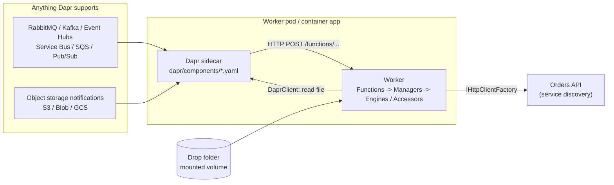

# Company.Product.Worker

A **Functions-style worker** (think Azure Functions) that runs on any cloud or on-prem. Small, testable **functions** run when:

- an **event** arrives: RabbitMQ locally, or Kafka, Azure Event Hubs, Azure Service Bus, AWS SNS/SQS, GCP Pub/Sub
- a **file** lands: in object storage (S3, Azure Blob, GCS) or in a drop folder

> **Scheduled work (cron) is not in this template.** A cron schedule fires once per replica, which clashes with autoscaling. Scheduled jobs live in the companion **`scheduler-dapr`** template, a small single-replica app. This worker can then scale from 0 to N freely on queue depth. See [Why there's no cron here](#why-theres-no-cron-here).

It's built on [Dapr](https://dapr.io) (Apache 2.0, a CNCF project). A Dapr sidecar next to the worker talks to the brokers and storage, and calls the worker's HTTP endpoints. **Switching from RabbitMQ to Event Hubs, or from local files to S3, is a YAML change in `dapr/components/`. No code changes.**

---

## Contents

1. [How it works](#how-it-works)
2. [Quick start](#quick-start)
3. [The sample functions](#the-sample-functions)
4. [Switching platforms](#switching-platforms)
5. [Adding a function](#adding-a-function)
6. [Reliability: retries, poison messages, idempotency](#reliability-retries-poison-messages-idempotency)
7. [Configuration](#configuration)
8. [Deploying](#deploying)
9. [Telemetry](#telemetry)
10. [Testing](#testing)
11. [Troubleshooting](#troubleshooting)

---

## How it works



| Function | Trigger | Endpoint | Dapr component |
|----------|---------|----------|----------------|
| `OrderPlacedFunction` | **Event**: `order-placed` topic | `POST /functions/order-placed` | `events` (pub/sub) |
| `ObjectCreatedFunction` | **File** created in object storage | `POST /functions/object-created` | `object-created` (input binding) + `object-storage` (output binding) |
| `DropFolderFunction` | **File** dropped in a folder | none: it polls the folder | none: a mounted volume |

Inside the worker, the same iDesign layers as the API apply: **Functions** (thin triggers) call **Managers** (use cases), which call **Engines** (pure logic) and **Accessors** (all I/O). Architecture tests enforce the layering. See [CLAUDE.md](CLAUDE.md).

---

## Quick start

**Prerequisites:** .NET 10 SDK, Docker Desktop, VS Code with C# Dev Kit. You don't need the Dapr CLI, because the sidecar runs in Docker. Run the **orders API** (the `idesign-api` template) on http://localhost:5080 so the functions have something to call.

### VS Code

Press **F5** and pick **Worker + Dapr + RabbitMQ (Docker)**. It:

1. Starts RabbitMQ, the telemetry dashboard, and a Dapr sidecar (`docker compose --profile debug up -d --wait`).
2. Builds and runs the worker on http://localhost:5100.
3. The sidecar connects to the worker, subscribes to `order-placed`, and listens on the `object-created` queue.

| URL | What |
|-----|------|
| http://localhost:15672 | RabbitMQ management (guest / guest) |
| http://localhost:18888 | Telemetry dashboard: logs and traces for every function run |
| http://localhost:3500 | Dapr sidecar HTTP API (used by `samples/requests.http`) |
| http://localhost:5100/metrics | Worker metrics (Prometheus format) |

### Try each function

Open `samples/requests.http` (with the REST Client extension) and send the requests:

| Function | How to trigger it |
|----------|-------------------|
| **Event** | `POST /v1.0/publish/events/order-placed`. The sidecar publishes to RabbitMQ, then delivers to the function |
| **File (object storage)** | Step 1 stores a CSV through the `object-storage` binding. Step 2 sends the S3-format "object created" notification to the `object-created` queue |
| **File (drop folder)** | Run the task **file: drop sample CSV**, or copy `samples/orders.csv` into `drop/incoming/`. It moves to `drop/processed/`. **file: drop invalid CSV** shows the `drop/failed/` path, with an `.error.txt` next to the file |

### Everything in containers

```bash
docker compose --profile container up --build     # worker on :8080, sidecar on :3500
```

---

## The sample functions

**Event: `OrderPlacedFunction`.** When an `order-placed` event arrives, it fetches the order from the orders API and sends an "order placed" notification. The notification Accessor currently writes to the log; replace it with a Dapr SMTP, SendGrid or Twilio binding, or with an HTTP Accessor. If the orders API doesn't know the order, the function returns **Drop** (no retry).

**File: `ObjectCreatedFunction` and `DropFolderFunction`.** Both import order CSV files through the same Manager (`FileImportManager`). The CSV is parsed and validated (`CsvOrderImportEngine`), and each order is created through the orders API.

```csv
order_ref,customer_name,sku,quantity,unit_price
A-1001,Contoso,WIDGET-1,10,25.00
A-1001,Contoso,GADGET-2,3,99.99
A-1002,Fabrikam,WIDGET-1,4,10.00
```

Lines with the same `order_ref` form one order. Every invalid line is reported with its line number, and an invalid file creates no orders.

The object-storage function understands the three notification formats, and detects which one it got:

| Store | Notification path | Format |
|-------|-------------------|--------|
| Amazon S3, MinIO, S3-compatible | Event notifications -> SQS (or a broker) | `{"Records":[{"eventName":"ObjectCreated:Put","s3":{...}}]}` |
| Azure Blob Storage | Event Grid -> Service Bus queue (or Event Hubs) | `Microsoft.Storage.BlobCreated`, Event Grid or CloudEvents schema |
| Google Cloud Storage | Pub/Sub notification (JSON payload) | object resource: `{"bucket":...,"name":...}` |

The drop folder works with any folder the container can mount: a local volume, NFS, SMB, Azure Files, EFS, Filestore, or an SFTP landing folder. Its layout:

```
drop/
├── incoming/      files to import (writers should upload as *.tmp / *.partial, then rename)
├── processing/    claimed by a worker instance (an atomic move, so replicas never double-process)
├── processed/     done: <timestamp>-<name>
└── failed/        rejected: <timestamp>-<name> + <timestamp>-<name>.error.txt
```

---

## Switching platforms

Components are matched **by name**, so replace the file and keep the name. Ready-made files are in [`dapr/examples/`](dapr/examples/README.md).

| Component | Local (`dapr/components/`) | Replace with |
|-----------|----------------------------|--------------|
| `events` | `pubsub.rabbitmq` | `pubsub.kafka`, `pubsub.azure.eventhubs`, `pubsub.azure.servicebus.topics`, `pubsub.aws.snssqs`, `pubsub.gcp.pubsub` |
| `object-created` | `bindings.rabbitmq` queue | `bindings.aws.sqs`, `bindings.azure.servicebusqueues`, `bindings.gcp.pubsub` |
| `object-storage` | `bindings.localstorage` | `bindings.aws.s3`, `bindings.azure.blobstorage`, `bindings.gcp.bucket` |

When `object-storage` changes, set `FileProcessing__ObjectStorage__KeyMetadataName` to match: `key` for S3 and GCS, `blobName` for Azure Blob, `fileName` for local storage.

Azure Event Hubs also speaks the Kafka protocol, so `pubsub.kafka` pointed at an Event Hubs namespace works too.

---

## Adding a function

Say you want to react to a `customer-registered` event:

1. **Contract:** `Functions/Models/CustomerRegisteredEvent.cs` (no suffix).
2. **Use case:** a Manager method (plus Engines for logic and Accessors for I/O) in `Managers/`, with unit tests.
3. **Function:** `Functions/CustomerRegisteredFunction.cs`. Keep it thin: call the Manager and map permanent failures to `PubSubResults.Drop()`.
4. **Wire it** in `Functions/Setup/FunctionsSetup.cs`:

   ```csharp
   app.MapPost(CustomerRegisteredFunction.Route,
           (CustomerRegisteredEvent e, CustomerRegisteredFunction f, CancellationToken ct) => f.RunAsync(e, ct))
       .WithTopic(PubSubName, CustomerRegisteredFunction.Topic);
   ```

   Also register it with `services.AddSingleton<CustomerRegisteredFunction>()` in `AddFunctions`.
5. **Try it:** add a publish request to `samples/requests.http`.

For a new **queue**, add a binding component to `dapr/components/` with `route: /functions/<name>` and map it with `MapBinding(...)`. In Claude Code, `/add-function <description>` walks through these steps.

---

## Reliability: retries, poison messages, idempotency

| Outcome | Event (pub/sub) | Binding (queue, notification) | Drop folder |
|---------|-----------------|-------------------------------------|-------------|
| Success | `200` | `200` | moved to `processed/` |
| **Transient** failure (API down, timeout) | exception, so `500`: Dapr retries (`resiliency.yaml`: exponential, 5 retries), then the dead-letter queue | exception, so `500`: redelivered by the broker | moved back to `incoming/`, retried next poll |
| **Permanent** failure (bad data, unknown order) | `PubSubResults.Drop()`: no retry | `200` with a warning log: not redelivered | moved to `failed/` + `.error.txt` |

**Every trigger is at-least-once.** A message can arrive twice, and a file can be re-imported if the worker crashes mid-way. Make functions idempotent. The sample file import isn't fully idempotent: re-importing a file creates its orders again. For production, send an idempotency key (the file name plus `order_ref`) to the API and let it ignore duplicates.

---

## Configuration

| Setting | Default | Description |
|---------|---------|-------------|
| `ExternalApis:Orders` | `https+http://orders-api` | Orders API address, resolved by service discovery |
| `Services:orders-api:http:0` | `http://localhost:5080` in Development | Service discovery endpoint. In Kubernetes, leave it unset: the `orders-api` Service name resolves through DNS |
| `FileProcessing:DropFolder:Enabled` | `false` (`true` in Development) | Turns the drop-folder poller on |
| `FileProcessing:DropFolder:Path` | `/data/drop` | Mounted folder root |
| `FileProcessing:DropFolder:PollInterval` | `00:00:10` | Wait between polls once the folder is empty |
| `FileProcessing:DropFolder:MinimumFileAge` | `00:00:05` | Skip files modified more recently than this (still being written) |
| `FileProcessing:ObjectStorage:BindingName` | `object-storage` | Dapr binding used to read files |
| `FileProcessing:ObjectStorage:KeyMetadataName` | `key` (`fileName` in Development) | `key` (S3, GCS), `blobName` (Azure Blob), `fileName` (local) |
| `DAPR_HTTP_PORT` / `DAPR_GRPC_PORT` | `3500` / `50001` | Where the worker reaches its sidecar. Dapr sets these on Kubernetes |
| `OTEL_EXPORTER_OTLP_ENDPOINT` | `http://localhost:4317` in Development | Telemetry collector |
| `Telemetry:PrometheusEndpoint:Enabled` | `true` | Serve `/metrics` |

Broker and storage settings live in the Dapr component files, not in app settings.

---

## Deploying

The worker is a normal container (port 8080, non-root user 1654, `/health` probe) that needs a Dapr sidecar.

### Kubernetes (any cloud: AKS, EKS, GKE, on-prem)

1. Install Dapr on the cluster: `helm install dapr dapr/dapr -n dapr-system --create-namespace` (or your cloud's Dapr add-on).
2. Apply the components for your platform, from `dapr/examples/`, as Kubernetes resources. Keep the names `events`, `object-created` and `object-storage`.
3. Annotate the Deployment so Dapr injects the sidecar:

```yaml
apiVersion: apps/v1
kind: Deployment
metadata:
  name: product-worker
spec:
  replicas: 2
  selector:
    matchLabels: { app: product-worker }
  template:
    metadata:
      labels: { app: product-worker }
      annotations:
        dapr.io/enabled: "true"
        dapr.io/app-id: "worker"
        dapr.io/app-port: "8080"
        dapr.io/config: "worker-config"
    spec:
      securityContext: { runAsNonRoot: true }
      containers:
        - name: worker
          image: <registry>/company-product-worker:1.0.0
          ports: [{ name: http, containerPort: 8080 }]
          env:
            - { name: OTEL_EXPORTER_OTLP_ENDPOINT, value: "http://otel-collector.observability:4317" }
            - { name: FileProcessing__ObjectStorage__KeyMetadataName, value: "key" }
          readinessProbe: { httpGet: { path: /health, port: http } }
          livenessProbe:  { httpGet: { path: /health, port: http } }
```

**Scaling like Functions:** add a [KEDA](https://keda.sh) `ScaledObject` on the queue or topic backlog (RabbitMQ queue length, Kafka lag, Service Bus, SQS, Pub/Sub). KEDA adds replicas when messages pile up and scales down (even to zero) when idle.

**Scaling to zero and the drop folder:** KEDA can scale this worker to zero because brokers hold the messages while no pod runs. The drop folder has no broker, so if you use it, set the KEDA `minReplicaCount: 1` (or turn the drop folder off and use object storage notifications).

**Scheduled jobs:** deploy the `scheduler-dapr` template alongside this worker. It runs as exactly one replica.

### Why there's no cron here

A Dapr cron binding lives in the sidecar, and **every replica has its own sidecar**. With 5 replicas, a "daily" job would run 5 times a day, and autoscaling would change that number. Events and files don't have this problem, because a queue gives each message to one consumer. So the two concerns are split:

| | This worker (`worker-dapr`) | `scheduler-dapr` |
|---|---|---|
| Triggers | Events, files | Schedules |
| Replicas | 0..N (KEDA on queue depth) | Exactly 1 (`strategy: Recreate`) |
| Scales on | Backlog | Nothing: jobs run on the clock |

**Drop folder:** mount a `ReadWriteMany` volume (NFS, Azure Files, EFS, Filestore) at `/data/drop`, and set `FileProcessing__DropFolder__Enabled=true`.

### Azure Container Apps

Container Apps has Dapr built in. Turn it on for the app (app ID `worker`, port 8080) and add the components to the environment. There's no Kubernetes to manage, and KEDA scale rules are built in too.

### Not supported: Azure App Service

App Service can't run the Dapr sidecar. Use Container Apps or Kubernetes, or run the worker without Dapr triggers (the drop folder only).

---

## Telemetry

It works the same as the API template: logs, traces and metrics through OpenTelemetry, exported over OTLP when `OTEL_EXPORTER_OTLP_ENDPOINT` is set, and scrapeable at `/metrics`. The sidecar's traces (`dapr/config.yaml`) go to the same endpoint, so one trace covers broker -> sidecar -> function -> orders API. Custom metrics:

| Metric | Meaning |
|--------|---------|
| `files.imported` (`source`, `outcome`) | Files handled by the drop folder and object storage functions, imported or rejected |
| `orders.imported` (`source`) | Orders created from files |

The production setup (OpenTelemetry Collector with Grafana/Prometheus, Azure, AWS or GCP) is described in the API template's README, "Production telemetry setup". It applies unchanged.

---

## Testing

```bash
dotnet test                         # or: docker build .  (runs every test)
```

| Suite | Covers |
|-------|--------|
| `Engines/` | Notification parsing (S3, MinIO, Event Grid, GCS), CSV validation, sales math |
| `Managers/` | File import (notification path, drop folder success, reject, transient release), order notifications |
| `Accessors/` | Orders API calls (stub HTTP handler), drop folder moves (real temp folder) |
| `Architecture/` | iDesign layering, no direct `HttpClient`, only Accessors use `DaprClient`/`IHttpClientFactory`, no I/O in Engines, model suffixes |
| `Host/` | Starts the worker in memory: `/dapr/subscribe` lists the topics, binding routes answer `OPTIONS`, `/health` and `/metrics` work |

---

## Troubleshooting

| Symptom | Fix |
|---------|-----|
| Sidecar logs `app channel is not initialized` or keeps waiting for the app | The worker isn't running on the expected port: 5100 for F5, 8080 in containers |
| Event function never runs | Check `GET http://localhost:5100/dapr/subscribe`, the sidecar logs (`docker compose logs dapr`), and the RabbitMQ UI for a queue named after `worker` and `order-placed` |
| `order-placed` is logged as dropped | The order id doesn't exist in the orders API. Publish an existing id |
| Every function call fails with 503 or a `ResourceAccessException` | The orders API isn't reachable. Check `Services:orders-api` (or `ExternalApis:Orders`) and that the API runs |
| Object-storage import fails reading the file | `KeyMetadataName` doesn't match the binding type (see [Switching platforms](#switching-platforms)), or the object doesn't exist |
| Drop-folder file stays in `incoming/` | It's younger than `MinimumFileAge`, has a `.tmp`/`.partial` name, the poller is off (`Enabled=false`), or the API is down (check the logs) |
| File stuck in `processing/` | The worker stopped mid-import. Move it back to `incoming/` |
